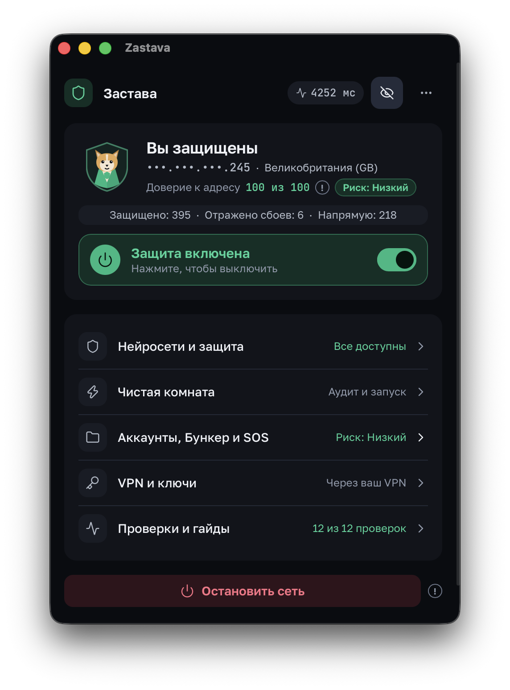
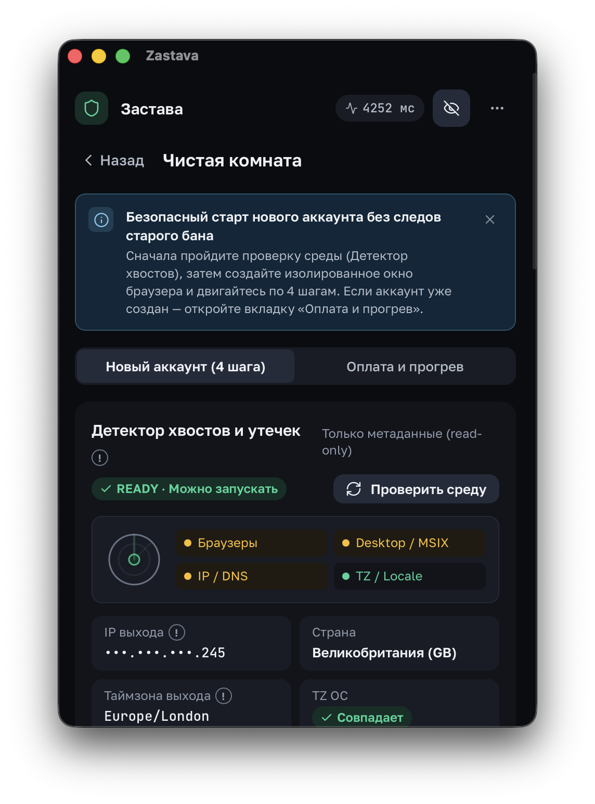
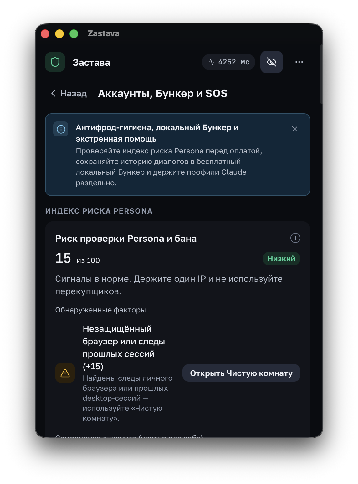
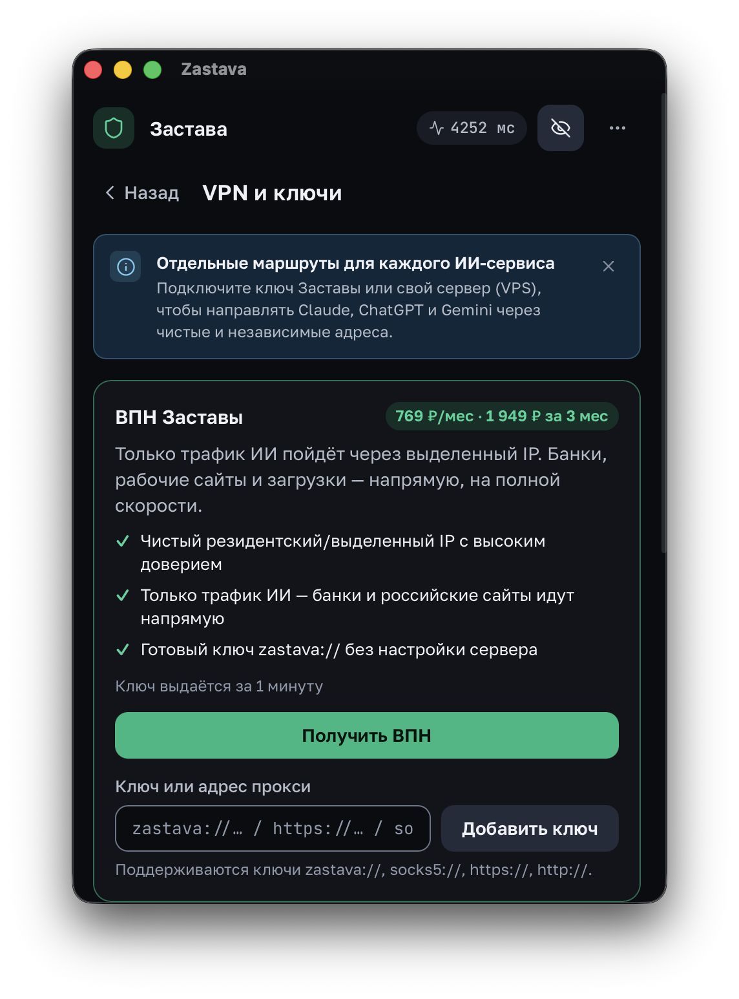

## Застава v3.0.0 — Чистая комната, локальный Бункер, SOS и новый интерфейс

**v3.0.0 — это не очередной минорный патч, а полный перезапуск.** Застава перестала быть просто локальным шлюзом и стала **первым open-source рабочим кокпитом для безопасной работы с ИИ и мультиаккаунтинга**, где всё собрано в одном окне `460×660` без скролла:

* **Перехват обрыва VPN за `0.04 мс` (Kill-Switch)** — ни один запрос к Claude, ChatGPT, Cursor, Antigravity или Gemini не уйдёт в открытую сеть с домашнего IP при падении туннеля или скачке ASN.
* **«Чистая комната» + Browser Sandbox (`127.0.1.x`)** — полная P0-изоляция браузерной сессии, где через выделенный прокси-алиас идёт **весь** трафик профиля (включая Stripe, Persona и Cloudflare Turnstile), без единой split-IP утечки.
* **Бесплатный локальный Бункер** — автоматически сохраняет проекты и диалоги Claude Code, Claude Desktop, Cursor IDE и веб-чатов с санитизацией секретов и готовым `RESTORE_PROMPT.md` для мгновенного переезда на новый аккаунт.
* **SOS-верификация и Persona Risk Index** — честная оценка риска до оплаты или проверки личности + пошаговый план действий при SMS, KYC/Persona, оплате и банах.
* **Интерфейс 460×660, маскот-сторож и 4-цветный трей** — нулевой скролл, живой статус всех контуров и мгновенная визуальная диагностика.

---

### Как выглядит Застава v3.0.0

<table>
  <tr>
    <td align="center" width="50%">
       
      <b>Главный хаб 460×660</b> — маскот, доверие к IP и быстрый статус
    </td>
    <td align="center" width="50%">
       
      <b>Чистая комната</b> — детектор хвостов и контроль утечек
    </td>
  </tr>
  <tr>
    <td align="center" width="50%">
       
      <b>Бункер и SOS</b> — Persona Risk Index и защита контекста
    </td>
    <td align="center" width="50%">
       
      <b>VPN и ключи</b> — выделенные маршруты для каждого ИИ
    </td>
  </tr>
</table>

---

### Почему v3.0.0 оставляет аналоги позади

Обычный VPN просто шифрует канал, но молча «протекает» при переподключении, оставляет домашний `TZ`/`DNS` и сливает все аккаунты в одном браузере. Антидетект-браузеры стоят от $30–100/мес, закрыты по исходникам и не защищают ни Cursor, ни Claude Code, ни системный CLI.

**Застава v3.0.0 закрывает все три контура сразу — бесплатно и с открытым кодом (Zero-MITM, без телеметрии):**
1. **Браузеры и изолированные профили** (`Browser Sandbox` + PAC-политики).
2. **Десктопные клиенты** (`Claude Desktop` с профилями и чисткой MSIX-кэша, `ChatGPT Desktop`, защита `CoworkVMService`).
3. **IDE и CLI-агенты** (`Claude Code`, `Cursor`, `Antigravity`, `Gemini CLI`, `VS Code`, `Windsurf`).

---

### Чистая комната + браузерная песочница (P0 изоляция без утечек)

Обычный PAC-режим пропускает через шлюз только домены ИИ, а платёжные шлюзы и антифрод-скрипты идут в обход — из-за этого возникает расхождение IP на **Stripe**, **Persona** и **Cloudflare Turnstile**. В v3.0.0 это решено архитектурно:

* **Детектор хвостов и утечек (read-only pre-flight):** перед запуском нового аккаунта Застава сканирует остаточные процессы, профили браузеров, кэш Desktop/MSIX, переменные окружения, IP/DNS и `TZ/Locale`, выставляя честный вердикт `READY`.
* **Per-profile Loopback Alias (`127.0.1.x`):** каждый профиль в **Browser Sandbox** получает собственный локальный прокси-алиас без `transit_tunnel` fallback. Весь трафик песочницы — включая оплату, верификацию и капчи — строго заперт в выбранном маршруте и мгновенно блокируется при `manual_killswitch`.
* **Два сценария:** **«Новый аккаунт (4 шага)»** для чистого старта и прямой вход **«Оплата и прогрев»** для уже созданных аккаунтов.

---

### Бесплатный локальный Бункер + SOS против Persona

Потерять аккаунт неприятно, но потерять месяцы контекста, правила проектов и историю в Cursor/Claude — катастрофа.

* **Локальный Бункер (Local Bunker):** бесплатный офлайн-архив с расписанием и ручным бэкапом. Автоматически сохраняет историю **Claude Code** (`~/.claude`), проекты **Cursor IDE**, сессии **Claude Desktop** и экспорт веб-чатов (**Claude**, **ChatGPT**, **Gemini**). Перед сохранением вырезает токены/секреты и генерирует готовый `RESTORE_PROMPT.md` для быстрого восстановления рабочего контекста.
* **Persona Risk Index (0–100):** честный скоринг факторов риска *до* того, как вы нажмёте «Оплатить» или пойдёте в верификацию — находит незащищённый браузер, хвосты прошлых сессий, расхождение TZ/DNS и историю IP.
* **Раздел «SOS-верификация»:** пошаговые антикризисные сценарии по SMS, проверке личности (KYC/Persona), оплате и разблокировке — без мифов и запрещённых «обходов», только рабочая гигиена и минимизация ложных триггеров.

---

### Интерфейс 460×660 + Маскот + 4-цветный трей

* **Хаб «Разделы» (`460×660`):** компактный zero-scroll интерфейс с мгновенным доступом к «Нейросетям и защите», «Чистой комнате», «Аккаунтам, Бункеру и SOS», «VPN и ключам», «Проверкам и гайдам».
* **Анимированный маскот-сторож:** в реальном времени отражает состояние защиты (`Вы защищены`, предупреждения, срабатывание Kill-Switch).
* **4-состоянный системный трей:** зелёный (всё чисто), жёлтый (есть предупреждение), красный (угроза/блок) и новый серый (`tray-gray.png`) при отключённой защите.
* **Режим «Скрыть IP» в шапке:** маскирует адрес до `•••.•••.•••.245` во всём интерфейсе для безопасных скриншотов.
* **Тарифы ВПН Заставы:** в интерфейсе отображаются актуальные условия (`769 ₽/мес · 1 949 ₽ за 3 мес`, выдача ключа `zastava://` за 1 минуту).

---

### Убойные фиксы под капотом (MSIX, Fake-IPv6, DNS, CoworkVMService, Build Provenance)

* **Windows MSIX Cache Cleaner (`cache_cleaner.rs`):** безопасная очистка кэша MSIX-версии Claude Desktop без повреждения системных контейнеров.
* **Анти-SSRF DNS fallback для TUN Fake-IPv6 (`leaks_dns.rs`):** корректная работа проверок утечек под TUN-клиентами с Fake-IPv6 без ложных тревог.
* **Ранний контроль `CoworkVMService`:** защита фоновых служб от утечки трафика до запуска шлюза Заставы.
* **GitHub Build Provenance (SLSA):** все релизные установщики сопровождаются криптографическими аттестациями происхождения (`actions/attest-build-provenance`) и подписью **minisign**.
* **Безопасный апгрейд `v2.x → v3.0.0`:** перед миграцией схемы автоматически создаётся однократный бэкап `state.v2.bak.json` — все ключи, маршруты и профили переносятся без потерь, а при первом запуске открывается экран «Что нового в v3.0».

---

### Скачать и обновиться

| Платформа | Файл релиза | Примечание |
| :--- | :--- | :--- |
| **macOS (Universal)** | `Zastava_3.0.0_universal.dmg` | Перетащите в `Applications`. Если Gatekeeper ругнётся: `xattr -cr /Applications/Zastava.app` |
| **Windows 10/11 (x64)** | `Zastava_3.0.0_x64-setup.exe` / `Zastava_3.0.0_x64_en-US.msi` | Установщик и MSI-пакет (проверены minisign + SLSA Build Provenance) |
| **Автообновление** | `Zastava_universal.app.tar.gz`, `*.sig`, `latest.json` | Обновление с `v2.x` через меню `···` → **«Проверить обновления»** (с автобэкапом `state.v2.bak.json`) |

> **Честно об ограничениях:** установщики пока не подписаны Apple Developer ID / Microsoft Authenticode (возможны стандартные предупреждения Gatekeeper / SmartScreen), а даже 100% зелёные проверки и «Чистая комната» не дают абсолютной гарантии от блокировок со стороны платёжных провайдеров, посредников или KYC. Подробный список технических изменений — в [CHANGELOG.md](https://github.com/kingbest1195/ai-antiban/blob/main/CHANGELOG.md).
