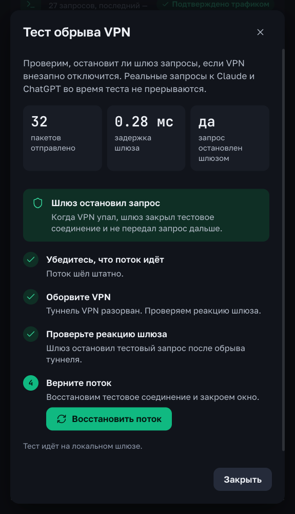

## Застава ${VERSION} — надёжное восстановление после обрыва VPN, честное покрытие клиентов и обновлённый интерфейс

Работаете в **Claude**, **ChatGPT**, **Cursor**, **Antigravity**, **Gemini** или консольных агентах через VPN? Достаточно одного короткого обрыва VPN или утечки DNS, чтобы следующий запрос ушёл с вашего домашнего IP. Самое неприятное — сам VPN в этот момент обычно молчит, а чат продолжает отвечать.

Застава садится перед запросами к ИИ как локальный фильтр на компьютере. Если VPN моргнул, сменился IP или вылезла другая страна — Застава ставит запрос к ИИ на паузу, пока вы не разберётесь. Остальной интернет, терминал и принтер при этом живут своей жизнью.

  
  
  

### Что исправлено и улучшено в ${VERSION}

* **Надёжное ядро при обрыве и восстановлении VPN («как часы»).**
  * Устранена 1-секундная перезагрузка аудита `ProbeRegular`, восстановлен мгновенный `Gate::Pending` с асинхронным уведомлением при смене сети.
  * Устранены «осиротевшие» 60-секундные таймауты очереди удержания (`HoldQueue`) за счёт `HoldResolution::Superseded` и `restore_epoch`, а также гонка кэша в `NetworkResolver`.
  * Исправлен ложный возврат в **«СТОП СЕТИ»** при возврате на закреплённый IP и починен клик **«Снять СТОП СЕТИ»** в трее.
* **Покрытие клиентов и домены Gemini.**
  * В доменный список Gemini добавлены `oauth2.googleapis.com` и `iamcredentials.googleapis.com`.
  * Исправлена ложная отметка `Configured` для **Antigravity** — теперь отображается реальный статус до запуска с переменными прокси.
  * В **Покрытие** и **Обзор** добавлено обнаружение **OpenCode**.
* **Понятный интерфейс.**
  * «Ключ Заставы» переименован в **«ВПН Заставы»**, добавлена зелёная кнопка **«Получить ВПН»**.
  * Удалены пустые окна промокодов, а стрелка у рекомендованных хостингов заменена на понятную кнопку **«Перейти»**.
* **Исправлена установка стража `CoworkVMServiceManualGuard` на Windows.** Задача планировщика Windows теперь создаётся из корректного XML (`UTF-16 LE BOM` и валидная схема без `ServiceAccount`), при `ERROR_ACCESS_DENIED` к реестру/SCM включается резервный перевод службы через `SYSTEM`-задачу, а точная причина ошибки из окна прав администратора пробрасывается напрямую в интерфейс.
* **Спокойный щит ИИ-сервисов без ложных блокировок.**
  * Жёлтые (`Yellow`) предупреждения (страны `KZ`, `RS`, часовой пояс, заметка AI Studio и др.) больше не блокируют трафик и не выбрасывают модальных окон — они остаются спокойной подсказкой.
  * Добавлено тихое авто-снятие блокировок, когда IP и проверки снова в норме.
  * Убрано ложное окно тревоги при старте на уже закреплённом или допустимом IP, а также повторные всплывающие окна для уже заблокированных сервисов.
* **Постоянные исключения `(Сервис + Exit IP)`.** Нажатие **«Разрешить принудительно»** теперь запоминает пару *сервис + выходной IP* в `state.json` (переживает перезапуски и смены сети). В **Настройках** можно посмотреть список исключений, удалить конкретное или очистить все сразу, а в «Обзоре» исправлена гонка при снятии блокировки.
* **Отдельные тумблеры мониторинга сервисов (Claude / ChatGPT / Gemini).** В **Настройках** можно выключить защиту для любого из трёх провайдеров: отключённый сервис исключается из проверок, PAC-скрипта и шлюза (при выключении Gemini исключаются и общие домены Google).
* **Надёжный мультиаккаунтинг и привязка ключей Заставы.**
  * Привязка `pinned_ips["anthropic"]` изолирована от остальных провайдеров; при смене профиля или ключа устаревшие блокировки автоматически снимаются.
  * Устранены гонки при записи `profiles.json`, корректно работает удаление активного профиля с переключением на резервный, а удаление привязанного к профилю ключа честно блокирует выход (`DanglingBinding`) вместо тихой отправки трафика в общую сеть.
  * Меню трея и список маршрутов в интерфейсе обновляются сразу после любых изменений профилей и ключей.

### Ключевые возможности линейки 2.2

* **Ключи Заставы (`zastava://`) поверх любого VPN (V2Box Pro, Happ Plus, AmneziaVPN и др.).** Автоматическая привязка браузеров и расширений через управляемые PAC-политики (плюс отключение QUIC и встроенного DoH, а на macOS — перезапуск открытых браузеров в один клик и спокойная работа при временных DNS VPN). Изолированная привязка IP, истории и блокировок по каждому маршруту и провайдеру без ложных «Скачков стран» и конфликтов между ИИ.
* **Проверки под TUN / FakeDNS и мгновенный часовой пояс.** Кнопка **«Синхронизировать для ИИ»** (*Рекомендуется*) сразу переводит проверку часового пояса в зелёный статус для приложений, CLI и IDE без смены системных часов ОС (синхронизация часов ОС вынесена в отдельную опцию для браузеров). Под TUN и FakeDNS корректно распознаётся Fake-IP (`198.18.0.0/15`) + публичный DNS, спам-базы проверяются через резервный DoH (`dns.google`), а таймаут IPv6 за kill-switch VPN не даёт ложных тревог.
* **Удобство и диагностика.** Пошаговый экран прогресса при выходе и обновлении, кнопка **«Скрыть IP»** в шапке для безопасных скриншотов, предупреждение о заблокированной для ИИ стране маршрута, причина перехвата и пауза **«До следующей смены сети»**, подписанный откат на предыдущие релизы GitHub и экспорт очищенного диагностического отчёта без ключей и IP.

### Базовые возможности (из линейки 2.1.x)

* **14 честных проверок сети** с 4 состояниями (включая серое «Не удалось проверить» вместо ложного «Чисто»), приоритизацией под **Claude**, **ChatGPT** и **Gemini** и 14-й проверкой реального выхода до ИИ-сервисов.
* **Безопасный возврат всех настроек:** журнал владения (`ownership/journal.json`) запоминает исходные значения и возвращает только то, что меняла сама Застава, включая сохранение завершающего переноса строки в профилях оболочки.
* **Режим «Только ИИ-клиенты и IDE» по умолчанию:** `npm`, `brew`, `git` и `cargo` работают напрямую; локальная сеть и Wi-Fi-принтеры (`*.local`, частные подсети) всегда идут в обход прокси.
* **Автозапуск в трей (`--minimized`)**, страж службы `CoworkVMService` на Windows, кнопка **«Перезапустить Antigravity с защитой»** на macOS, изолированные профили **Claude Vault**, тест обрыва VPN и автообновления с криптоподписью **minisign**.

### Установка и обновление

* **macOS (Apple Silicon и Intel):** откройте `.dmg` и перетащите Zastava в `Applications`. Приложение не подписано Apple Developer ID — если macOS ругнётся при первом запуске, выполните в Терминале:
  `xattr -cr /Applications/Zastava.app`
* **Windows 10 / 11 (x64):** запустите `-setup.exe` или `.msi`.
* **Обновление с 2.1.x / 2.2.0:** нажмите «Обновить» внутри приложения — пакет проверяется криптоподписью **minisign** до установки, а перед перезапуском Застава аккуратно вернёт системные настройки на экране обновления.

### Известные ограничения (честно)

* **Подпись ОС.** Установщики не подписаны Apple Developer ID и Microsoft Authenticode: Gatekeeper, SmartScreen и антивирусы могут выдавать предупреждение. Подпись minisign защищает целостность автообновлений, но предупреждения ОС не убирает.
* **Split tunneling (Throne, Amnezia и др.).** Если VPN маршрутизирует только отдельные домены или приложения, включите переключатель **«Выборочная маршрутизация VPN (split tunneling)»** в настройках и при необходимости добавьте процесс `zastava` в правила вашего VPN.
* **Временные DNS VPN на macOS.** Если вы закрываете Заставу при активном VPN с временными DNS, откат системного PAC откладывается до следующего запуска, чтобы не сбросить DNS у VPN (Застава об этом предупредит).
* **Откат на 2.0.0.** Журнал владения от 2.1.0+ несовместим с более старыми версиями — перед откатом сначала выключите защиту в текущей версии.
* **JetBrains.** Статус в «Покрытии» пока «Неизвестно», пока формат файла настроек не подтверждён на живой установке.
* **Гарантии по аккаунтам.** Даже все 14 зелёных проверок не дают гарантии, что сервис не ограничит аккаунт по другим причинам (оплата, поведение и т.д.).

### Благодарности

* **Алексей** — за макеты и разбор интерфейса.
* **Александр** — за подробный разбор 2.0 и кейсы по безопасной очистке системных настроек.
* **Станислав** — за подробный разбор интерфейса, предложения по правкам в UI/UX и готовые примеры кода.

### Файлы релиза

| Что скачать | Для чего |
| :--- | :--- |
| `.dmg` (macOS, universal) | установка на macOS |
| `-setup.exe` или `.msi` (Windows, x64) | установка на Windows |
| `.app.tar.gz`, `.sig`, `.exe.sig`, `.msi.sig` | автообновление и подписи |
| `latest.json` | манифест обновлений |

Подробный технический список изменений: [CHANGELOG.md](https://github.com/kingbest1195/ai-antiban/blob/main/CHANGELOG.md).
