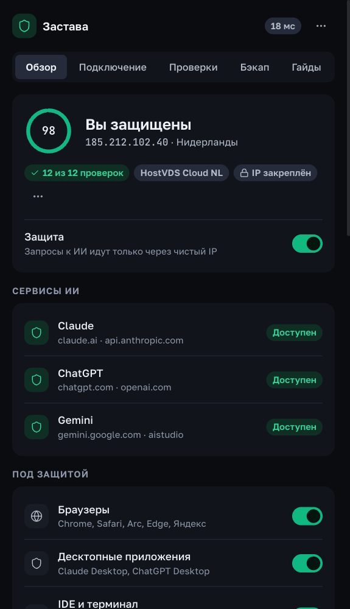

## Застава ${VERSION} — ключи ИИ поверх любого VPN, умные проверки и чистый выход

Работаете в **Claude**, **ChatGPT**, **Cursor**, **Antigravity**, **Gemini** или консольных агентах через VPN? Достаточно одного короткого обрыва VPN или утечки DNS, чтобы следующий запрос ушёл с вашего домашнего IP. Самое неприятное — сам VPN в этот момент обычно молчит, а чат продолжает отвечать.

Застава садится перед запросами к ИИ как локальный фильтр на компьютере. Если VPN моргнул, сменился IP или вылезла другая страна — Застава ставит запрос к ИИ на паузу, пока вы не разберётесь. Остальной интернет, терминал и принтер при этом живут своей жизнью.

  
  
  

### Что нового в ${VERSION}

1. **Маршрутизация ключей Заставы и работа поверх VPN (V2Box Pro, Happ Plus, AmneziaVPN и др.).**
   * **Автоматическая привязка браузеров и расширений через управляемые PAC-политики и `Preferences`:** при включении защиты Застава автоматически прописывает `ProxyMode = "pac_script"` и `ProxyPacUrl` (вместе с отключением QUIC и встроенного DoH) в управляемые политики и файлы `Preferences` профилей Chromium-браузеров (Chrome, Brave, Edge, Chromium, Vivaldi, Yandex Browser, Arc, Comet, Opera, Opera GX, Dia, OpenAI Atlas, Chrome/Brave Beta и др.) и встроенных ИИ-расширений, включая полный набор эндпоинтов Google/Gemini. Для уже открытых браузеров в один клик доступна кнопка **«Перезапустить браузеры»** (мягкое закрытие, запись PAC в `Preferences` и запуск с `--proxy-pac-url`), чтобы ключи Заставы работали поверх любого TUN VPN; при выключении или выходе всё аккуратно откатывается.
   * **Работа с Happ Plus и AmneziaVPN на macOS без ошибки временного DNS при включении защиты:** если активный VPN держит временные настройки DNS, Застава больше не отказывает во включении защиты — запись системного PAC через `networksetup` бережно откладывается (чтобы не сбросить DNS VPN), а управляемые PAC-политики браузеров и защита CLI/IDE включаются сразу; неактивные сетевые интерфейсы с устаревшими записями DNS игнорируются.
   * **Изоляция привязки IP, истории и блокировок по маршрутам и провайдерам:** закреплённый IP и история IP (`ip_history`) теперь изолированы по каждому маршруту, а блокировка `NetworkGuard` действует по конкретному провайдеру. Сервисы на выделенном ключе Заставы получают статус `PINNED_BY_ZASTAVA_KEY` без конфликта с основным VPN, без ложных срабатываний «Скачков стран» (`Impossible Travel`) и без побочной блокировки других ИИ-провайдеров.
   * **Устранение ложного предупреждения UDP на ключах Заставы:** если трафик ИИ идёт по TCP через ключ Заставы (при отключённом QUIC), а системный UDP/STUN не раскрывает домашний/санкционный IP, проверка честно показывает зелёный статус.

2. **Часовые пояса без лишних предупреждений.**
   * **Мгновенная синхронизация для ИИ:** кнопка **«Синхронизировать для ИИ»** (*Рекомендуется*) сразу переводит проверку часового пояса в зелёный статус для приложений, CLI и IDE без необходимости менять системные часы ОС.
   * **Разделение на два уровня:** синхронизация системного времени ОС вынесена в отдельную необязательную опцию (*Опционально — только для браузера*), а в «Покрытии» и окне часового пояса добавлено ненавязчивое напоминание для браузеров и расширений.
   * **Мгновенное обновление статуса:** устранён 45-секундный кэш при переключении тумблера — после нажатия перепроверяются все три провайдера сразу.

3. **Проверки DNS, спам-баз (DNSBL) и IPv6 под TUN / FakeDNS.**
   * **Распознавание связки Fake-IP (`198.18.0.0/15`) + публичный DNS (Cloudflare):** проверка DNS-резолвера больше не срывается в «Не удалось проверить», если один из источников вернул Fake-IP туннеля, а второй подтвердил публичный резолвер; в чистом Fake-IP режиме без резолверов РФ проверка корректно даёт зелёный статус.
   * **Резервный канал DoH для спам-баз (DNSBL):** если системный резолвер под FakeDNS или публичный `1.1.1.1` блокирует DNSBL-запросы, Застава автоматически опрашивает спам-базы через DoH (`dns.google`), чтобы проверка стабильно проходила поверх любого режима V2Box Pro и других TUN VPN.
   * **Устойчивость проверки IPv6 к kill-switch VPN:** если IPv6-проба уходит в таймаут из-за блокировки kill-switch в VPN, проверка засчитывает защиту как зелёную вместо ложного предупреждения.

4. **Новый экран завершения работы и обновления, плашка VPN и онбординг v2.2.**
   * **Пошаговый прелоадер при выходе и обновлении:** зачистка настроек при закрытии приложения и перед перезапуском обновления теперь выполняется однократно и показывает понятный экран с прогресс-баром по 4 шагам (остановка шлюза, восстановление прокси и политик браузеров, очистка терминала/IDE, восстановление часового пояса ОС).
   * **Кнопки быстрых действий в плашке VPN:** прямо в карточке сосуществования с VPN в «Покрытии» появились кнопки **«Перезапустить браузеры»** (в один клик для открытых браузеров без PAC), **«Привязать браузеры»** (или «Обновить привязку браузеров»), **«Перепроверить»** и **«Настройки сети ОС»**. Когда браузеры уже привязаны, плашка показывается в спокойном информационном стиле вместо тревожного предупреждения.
   * **Полностью обновлённый онбординг под v2.2:** переработан под сосуществование с VPN, ключи `zastava://` для отдельных ИИ, разделение защиты браузеров и CLI/IDE и два уровня синхронизации часового пояса; флаг прохождения теперь хранится в `state.json`.

5. **Новые возможности v2.2.**
   * **Режим «Скрыть IP» в один клик:** переключатель в шапке маскирует IP-адреса и подсети во всём интерфейсе для безопасных скриншотов.
   * **Предупреждение о заблокированной для ИИ стране маршрута:** в разделе «Подключение» сразу отображается явная плашка, если выбранный маршрут или VPN выходит в неподдерживаемую страну для Claude, ChatGPT или Gemini; подписи стран маршрутов приведены к чистому виду без дублирования (`Франция (FR)`, `Нидерланды (NL)`).
   * **Подписанный откат на предыдущие релизы GitHub:** в «Настройках → Версия и откат» можно безопасно вернуться к предыдущей версии с проверкой криптоподписи minisign.
   * **Причина перехвата (`gate_reason`) и пауза «До следующей смены сети»:** при срабатывании защиты окно перехвата показывает точную причину блокировки и позволяет поставить паузу до следующей смены сетевого интерфейса или IP.
   * **Экспорт очищенного диагностического отчёта и предпросмотр изменений:** выгрузка диагностического отчёта в JSON без ключей `zastava://`, паролей и IP-адресов, а также окно предпросмотра всех файлов и политик, которые Застава меняет в системе.

### Базовые возможности (из линейки 2.1.x)

* **14 честных проверок сети** с 4 состояниями (включая серое «Не удалось проверить» вместо ложного «Чисто»), приоритизацией под **Claude**, **ChatGPT** и **Gemini** и 14-й проверкой реального выхода до ИИ-сервисов.
* **Безопасный возврат всех настроек:** журнал владения (`ownership/journal.json`) запоминает исходные значения и возвращает только то, что меняла сама Застава, включая сохранение завершающего переноса строки в профилях оболочки.
* **Режим «Только ИИ-клиенты и IDE» по умолчанию:** `npm`, `brew`, `git` и `cargo` работают напрямую; локальная сеть и Wi-Fi-принтеры (`*.local`, частные подсети) всегда идут в обход прокси.
* **Автозапуск в трей (`--minimized`)**, страж службы `CoworkVMService` на Windows, кнопка **«Перезапустить Antigravity с защитой»** на macOS, изолированные профили **Claude Vault**, тест обрыва VPN и автообновления с криптоподписью **minisign**.

### Установка и обновление

* **macOS (Apple Silicon и Intel):** откройте `.dmg` и перетащите Zastava в `Applications`. Приложение не подписано Apple Developer ID — если macOS ругнётся при первом запуске, выполните в Терминале:
  `xattr -cr /Applications/Zastava.app`
* **Windows 10 / 11 (x64):** запустите `-setup.exe` или `.msi`.
* **Обновление с 2.1.x:** нажмите «Обновить» внутри приложения — пакет проверяется криптоподписью **minisign** до установки, а перед перезапуском Застава аккуратно вернёт системные настройки на новом экране обновления.

### Известные ограничения (честно)

* **Подпись ОС.** Установщики не подписаны Apple Developer ID и Microsoft Authenticode: Gatekeeper, SmartScreen и антивирусы могут выдавать предупреждение. Подпись minisign защищает целостность автообновлений, но предупреждения ОС не убирает.
* **Split tunneling (Throne, Amnezia и др.).** Если VPN маршрутизирует только отдельные домены или приложения, включите переключатель **«Выборочная маршрутизация VPN (split tunneling)»** в настройках и при необходимости добавьте процесс `zastava` в правила вашего VPN.
* **Временные DNS VPN на macOS.** Если вы закрываете Заставу при активном VPN с временными DNS, откат системного PAC откладывается до следующего запуска, чтобы не сбросить DNS у VPN (Застава об этом предупредит).
* **Откат на 2.0.0.** Журнал владения от 2.1.0+ несовместим с более старыми версиями — перед откатом сначала выключите защиту в текущей версии.
* **JetBrains.** Статус в «Покрытии» пока «Неизвестно», пока формат файла настроек не подтверждён на живой установке.
* **Гарантии по аккаунтам.** Даже все 14 зелёных проверок не дают гарантии, что сервис не ограничит аккаунт по другим причинам (оплата, поведение и т.д.).

### Благодарности

* **Алексей** — за макеты и разбор интерфейса.
* **Александр** — за подробный разбор 2.0 и кейсы по безопасной очистке системных настроек.
* **Станислав** — за подробный разбор интерфейса, предложения по правкам в UI/UX и готовые примеры кода.

### Файлы релиза

| Что скачать | Для чего |
| :--- | :--- |
| `.dmg` (macOS, universal) | установка на macOS |
| `-setup.exe` или `.msi` (Windows, x64) | установка на Windows |
| `.app.tar.gz`, `.sig`, `.exe.sig`, `.msi.sig` | автообновление и подписи |
| `latest.json` | манифест обновлений |

Подробный технический список изменений: [CHANGELOG.md](https://github.com/kingbest1195/ai-antiban/blob/main/CHANGELOG.md).
