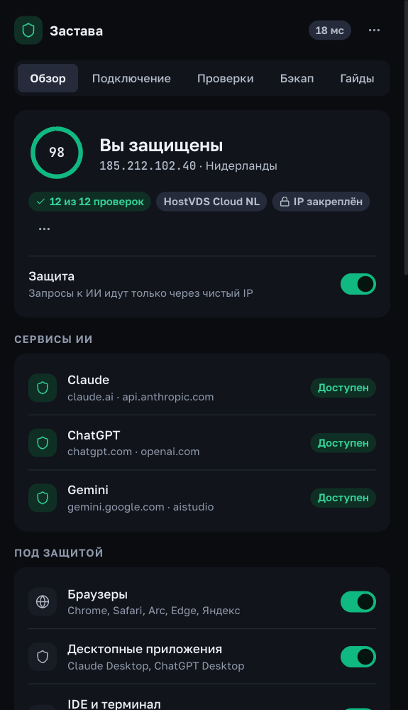
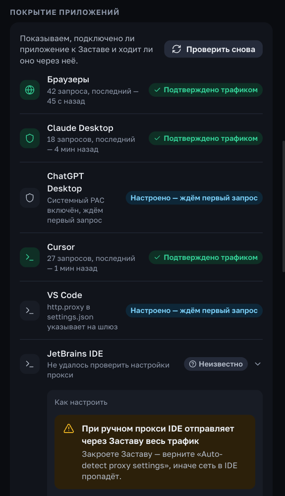
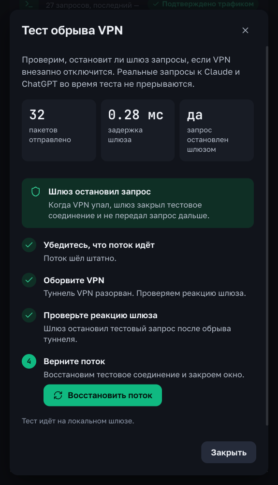

## Застава ${VERSION} — Полная пересборка: 3 контура защиты, радар покрытия приложений, цепочка PAC и маршруты по сервисам

Масштабное обновление локального сетевого экрана для безопасной работы с **Claude**, **ChatGPT**, **Cursor**, **Antigravity**, **Gemini** и **CLI-агентами** без банов, потери контекста и конфликтов с вашим VPN.

  
  
  

### 🔥 Главное в ${VERSION} (по фактам):

1. **Три независимых контура защиты + живой радар «Покрытие приложений»**:
   - Отдельное управление защитой для **Браузеров** (`Chrome, Safari, Arc, Edge, Яндекс`), **Десктопных клиентов** (`Claude Desktop, ChatGPT Desktop`) и **IDE / Терминала** (`Antigravity, Cursor, VS Code, Windsurf, Claude Code, Gemini CLI`).
   - Новый радар **«Покрытие приложений»** сопоставляет входящие соединения на локальном шлюзе `127.0.0.1:8899` с процессами вашей ОС и показывает в реальном времени, какие приложения идут через защиту и сколько запросов проверено.

2. **Цепочка системного PAC (`PAC Chaining`)**:
   - Застава больше не конфликтует с VPN-клиентами в режиме системного прокси (`v2rayN`, `Throne`, `Hiddify`, `Happ`) и работает поверх `TUN` (`Amnezia`, `WireGuard`).
   - Шлюз автоматически запоминает прокси вашего VPN-клиента: запросы к ИИ идут через фильтр Заставы, а весь остальной трафик компьютера возвращается в ваш обычный VPN или идёт напрямую.

3. **Маршрутизация по сервисам (`routes`), ключи `zastava://` v2 и режим `fail-closed`**:
   - Привязывайте отдельные ключи или прокси к каждому сервису (`Claude`, `ChatGPT`, `Gemini` и отдельно к каждому профилю `Claude Desktop`).
   - Нативная поддержка HTTPS-прокси на `rustls` (CONNECT внутри TLS), вставка ключей `zastava://` в 1 клик с подтверждением и сторож активных туннелей **`RouteWatch`**: при истечении или падении ключа сокет мгновенно закрывается (по замыслу — без отката на домашний IP).

4. **Новый лаконичный интерфейс на собственной дизайн-системе (`Zastava DS`)**:
   - Чистая навигация по 5 вкладкам (**Обзор · Подключение · Проверки · Бэкап · Гайды**), 4-шаговый онбординг, проверка 12 контуров безопасности (IP, ASN, спам-базы, утечки IPv6/DNS, Wi-Fi гео, синхронизация таймзоны в 1 клик) и интерактивный **Тест обрыва VPN**.
   - Подписанный гибридный автоапдейтер (`tauri-plugin-updater` с проверкой `minisign`-подписи + полная обратная совместимость с версиями `v1.3.x`).

---

### ⬇ Установка и обновление:
- **macOS (Apple Silicon M1–M4 и Intel)**: скачайте `.dmg`, перетащите `Zastava` в `Applications` *(если macOS покажет предупреждение Gatekeeper: `xattr -cr /Applications/Zastava.app`)*.
- **Windows 10 / 11 (x64)**: скачайте `-setup.exe` или `.msi` и запустите установку.
- **Обновление с версий v1.3.x**: нажмите `Обновить` прямо внутри приложения.
