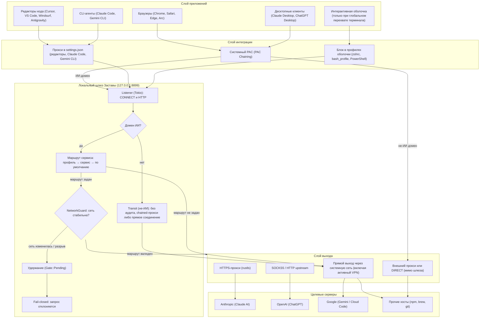

# Архитектура Застава v2.3.0

Документ описывает внутреннее устройство настольного приложения **Застава v2.3.0** (актуальное состояние и целевая 4-слойная модульная архитектура, закреплённая в [`CONSTITUTION.md`](CONSTITUTION.md)): потоки данных, модульную структуру ядра на Rust, компонентную модель пользовательского интерфейса и инварианты безопасности.

---

## 1. Общий стек и концепция

Застава построена на базе гибридного фреймворка **Tauri v2**:
* **Backend (Ядро)**: Rust (`edition = "2024"`, `src-tauri/`), асинхронный рантайм Tokio, TLS на базе `rustls` и `ring`, DNS на базе `hickory-resolver`. Выполняет функции локального шлюза, сторожа маршрутов, аудитора сети (14 проверок) и менеджера системных настроек (прокси, PAC, политики браузеров, файлы редакторов и CLI, часовой пояс ОС, защита `CoworkVMService`).
* **Frontend (Интерфейс)**: React 19, TypeScript, Vite, Tailwind CSS 4 (`src/`). Работает в WebView без прямого доступа к API операционной системы и обменивается с ядром типизированным IPC (`invoke` / `listen`) исключительно через транспортный слой `src/utils/api`.
* **Дизайн-система**: Zastava Design System (`src/ui/`, `src/styles/tokens.css`). Цвета задаются только CSS-переменными; сырых hex-значений и `rgb()`/`rgba()` в `src/ui/` и `src/features/` нет.
* **Архитектурные стражи CI**:
  * [`scripts/check-architecture.mjs`](scripts/check-architecture.mjs) — соблюдение 4-слойной иерархии зависимостей, лимитов размера файлов (`<= 500L` prod / `<= 700L` test), изоляция `fakes.rs` и запрет `invoke()` вне `src/utils/api/`.
  * [`scripts/check-tray-main-thread.mjs`](scripts/check-tray-main-thread.mjs) — все операции с иконкой трея и меню только в главном потоке (`tray/`).
  * [`scripts/check-no-hex.mjs`](scripts/check-no-hex.mjs) — отсутствие сырых цветов вне токенов дизайн-системы.

---

## 2. Целевая 4-слойная архитектура ядра (`src-tauri/src/`)

Начиная с **v2.3.0**, модули Rust-ядра организованы в строгий **ацикличный 4-слойный граф (Clean Hexagonal / Ports & Adapters + Vertical Domain Slices)**. Зависимости направлены исключительно сверху вниз:

```text
┌─────────────────────────────────────────────────────────────────────────┐
│ Layer 3: Delivery / Shell                                               │
│   main.rs, lib.rs (composition root)                                    │
│   app/ (lifecycle, watchers, deep_links)                                │
│   commands/* (тонкие IPC-адаптеры без бизнес-логики)                    │
│   tray/, popup.rs, startup.rs, autostart.rs                             │
├─────────────────────────────────────────────────────────────────────────┤
│ Layer 2: Domain Services & Platform Adapters                            │
│   proxy/{guard, server, coverage, transit, upstream, pac, hold_queue}   │
│   auditor/{checks, network, seams, profile_switcher, probes, leaks}     │
│   sysproxy/{platform, browser_policies, journal, cleanup, relaunch}     │
│   updater/, cowork_guard/, os_tz/, diagnostics/, bin_checker/, win_reg/ │
│   (общаются с Layer 3 только через Trait Ports / callbacks!)            │
├─────────────────────────────────────────────────────────────────────────┤
│ Layer 1: State & Routing Contracts                                      │
│   state/{schema, migration, persistence, stats, pinning, routes, ...}   │
│   routing/{mod, key, net}                                               │
├─────────────────────────────────────────────────────────────────────────┤
│ Layer 0: Core Primitives (0 зависимостей на Tauri и доменные сервисы)   │
│   core/{net_safety, sanctions, redact} + sanctions.rs                   │
└─────────────────────────────────────────────────────────────────────────┘
```

### Ключевые принципы расслоения:
* **Инверсия контроля через Ports**: доменные сервисы (`proxy/guard`, `sysproxy`) не импортируют `commands::*`, `app::*` или `tray::*`. Взаимодействие с оболочкой (перезапуск приложения, проверка pinning, показ окна предупреждения, обновление трея) выполняется через трейты-порты (например, `AppLauncher` в `sysproxy/relaunch`, `GuardIo` / `PinningPort` в `proxy/guard`).
* **Единый Layer 0 (`core/`)**: общие примитивы безопасности (`is_tun_fake_ip`, `is_forbidden_ip`, `validate_tunnel_target`, санкционные проверки гео/локалей, санитизация диагностических текстов и секретов) вынесены в `core/` и переиспользуются без дублирования в `proxy`, `auditor`, `routing` и `diagnostics`.
* **Разделение prod / fakes / tests**: production-модули, тестовые двойники (`fakes.rs` под `#[cfg(any(test, feature = "test-support"))]`) и крупные тестовые наборы (`tests.rs` / `tests/*.rs`) разделены по отдельным файлам (см. [`CONSTITUTION.md`](CONSTITUTION.md)).

---

## 3. Схема движения трафика



---

## 4. Модули ядра Rust (`src-tauri/src/`)

```text
src-tauri/src/
├── main.rs            # Точка входа; CLI-флаги --cleanup и --install-cowork-guard
├── lib.rs             # Инициализация Tauri-плагинов, сборка стейта и регистрация IPC
├── core/              # [Layer 0] Чистые примитивы: net_safety, sanctions, redact
├── state/             # [Layer 1] Потокобезопасное состояние AppState, миграции и статистика
├── routing/           # [Layer 1] Модель маршрутов v2, парсинг ключей, SSRF-валидация
├── proxy/             # [Layer 2] Локальный шлюз, PAC, NetworkGuard, HoldQueue, радар покрытия
├── auditor/           # [Layer 2] 14 проверок сети, Claude Vault, правила (встроенные JSON)
├── sysproxy/          # [Layer 2] Системные настройки, журнал владения, политики браузеров и CLI
├── updater/           # [Layer 2] Проверка обновлений и установка только подписанного пакета
├── cowork_guard/      # [Layer 2] Защита CoworkVMService (Windows) и мониторинг помощников (macOS)
├── os_tz/             # [Layer 2] Синхронизация и восстановление системного часового пояса
├── diagnostics/       # [Layer 2] Кольцевой буфер диагностических событий и экспорт
├── bin_checker/       # [Layer 2] Проверка префикса платёжной карты: локальные правила и справочник
├── win_reg/           # [Layer 2] Безопасная обёртка над реестром Windows
├── app/               # [Layer 3] Жизненный цикл приложения, фоновые наблюдатели, deep-link
├── commands/          # [Layer 3] Тонкие IPC-хэндлеры Tauri (95 команд, разбиты по доменам)
├── tray/              # [Layer 3] Системный трей / меню-бар; операции с иконкой в главном потоке
├── popup.rs           # [Layer 3] Позиционирование и показ окна alert-popup
├── startup.rs         # [Layer 3] Оркестрация фаз запуска приложения (startup://phase)
└── autostart.rs       # [Layer 3] Настройка автозапуска на macOS и Windows
```

### 4.1. `proxy/` — Шлюз, PAC и сторож маршрутов
* **`server/`**: асинхронный сервер на `127.0.0.1:8899` (при занятом порте — запасной). Принимает `HTTP CONNECT` и HTTP-запросы. Для доменов ИИ определяет маршрут и устанавливает туннель через `tokio::io::copy_bidirectional`. Для остальных доменов выполняет transit: без аудита и без гейта, через chained-прокси, а при его недоступности — напрямую (однократно). Цели проверяются политикой SSRF (`core::net_safety`): порты `80`, `443`, `8443`; внутренние имена и приватные адреса отклоняются ответом `403`.
* **`http_forward/`**: разбор HTTP-запроса (абсолютная и относительная форма), очистка hop-by-hop заголовков, пересылка тела. Используется для plain HTTP в transit. Запросы к доменам ИИ по HTTP не пересылаются.
* **`transit.rs`**: исходящая сторона для transit: кэш DNS (положительные ответы 60 с, отрицательные 5 с, до 512 имён), проверка каждого ответа на приватные адреса, Happy Eyeballs (RFC 8305, шаг 250 мс).
* **`guard/` (`NetworkGuard`)**: отслеживает отпечаток маршрутов ОС и внешний IP. При смене сети переводит шлюз в `Gate::Pending`: ИИ-запросы удерживаются в `HoldQueue` до завершения проверки. Ручной «СТОП СЕТИ» (`manual_killswitch`) останавливает весь проксируемый трафик, включая transit и привязанные маршруты. Transit не зависит от гейта: перепроверка сети не обрывает уже идущие загрузки.
* **`hold_queue.rs` (`HoldQueue`)**: буфер новых соединений на время переключения маршрута и ожидания решения пользователя.
* **`pac.rs`**: генератор `proxy.pac`. Первым правилом возвращает `DIRECT` для локальной сети (`*.local`, `10/8`, `172.16/12`, `192.168/16`, `169.254/16`, `127/8`). Затем домены ИИ уходят на шлюз, остальное — в `PROXY <chained>; DIRECT` либо в `DIRECT`.
* **`upstream/`**: клиенты внешних точек выхода: SOCKS5 / SOCKS5h, HTTP CONNECT, HTTPS-прокси на `tokio-rustls` (CONNECT внутри TLS до входной ноды).
* **`route_watch.rs` (`RouteWatch`)**: фоновый сторож активных upstream-маршрутов: статус и задержка, переключение на резервный узел.
* **`coverage/`**: радар «Покрытие приложений». Статус приложения — по факту: подтверждён трафиком через шлюз, настроен (по системной или файловой настройке), неизвестен или не настроен. Для обычного (transit) трафика `lsof` не вызывается; процесс по порту определяется кэшем с ограничением частоты.

### 4.2. `routing/` — Маршрутизация по сервисам и ключи v2
* **`mod.rs`**: структура `Route`, привязки сервисов (`provider_routes`), выбор маршрута (`Profile Route → Provider Route → Default Route`). Если маршрут не задан, выбирается `Direct`. Если маршрут задан, но отключён, истёк или недоступен (`__direct__`, `profile:invalid`), запрос отклоняется (fail-closed). `profile_route_id` применяется исключительно к `anthropic`.
* **`key/`**: парсер ключей `zastava://` (версии 1 и 2) и прямых URL прокси. Поддерживает несколько входных узлов (`entry[]`), метки, `exit_ip`, срок действия. Пароли маскируются в `redacted_for_ui`.
* **`net/`**: проверка адресов входных узлов (SSRF-защита: loopback, приватные диапазоны, link-local, облачные метаданные `169.254.169.254`).

### 4.3. `auditor/` — 14 проверок сети и Claude Vault
* **`mod.rs` + `run_check.rs`**: запуск 14 проверок, каждая в своей задаче с лимитом времени. Сбой или паника проверки даёт статус «Не удалось проверить», а не «Чисто». Итог: счётчики «пройдено / не удалось / требует внимания», флаг неполного отчёта.
* **`network/`**: сетевые метаданные по каскаду: `ipwho.is` → `ipinfo.io` → `freeipapi.com` → `1.1.1.1/cdn-cgi/trace`.
* **`probes/whoami.rs` & `probes/public_dns.rs`**: проверка DNS-резолвера. Системный резолвер запрашивает `whoami.akamai.net` (A) и `o-o.myaddr.l.google.com` (TXT). Если оба источника не ответили, проверка получает статус «Не удалось проверить».
* **`probes/stun.rs`**: UDP/STUN-проба (`stun.cloudflare.com:3478`, `stun.l.google.com:19302`), сравнение адреса с адресом выхода.
* **`dnsbl/`**: параллельный опрос 5 зон (`zen.spamhaus.org`, `dnsbl.dronebl.org`, `b.barracudacentral.org`, `bl.spamcop.net`, `dnsbl-1.uceprotect.net`). Каждая зона проверяется контрольным адресом `127.0.0.2`. «Чисто» засчитывается при ответе минимум двух зон. Адреса вне `127.0.0.0/8` (например, fake-IP DNS) считаются непригодным ответом.
* **`geo_matrix/`**: матрица доступности сервисов по странам (правила в `rules/provider_matrix.json`).
* **`history.rs`**: история внешних IP, `IP Pinning` (в строгом режиме смена адреса даёт критичный статус) и `Impossible Travel`.
* **`os_env.rs` & `leaks.rs`**: часовой пояс (сравнение по смещению UTC, допуск 1 час), локаль и переменные `TZ`/`LANG`/`LC_TIME`, утечки IPv6, службы геолокации ОС.
* **`rules.rs`**: встроенные правила (`dangerous_asns.json`, `provider_matrix.json`), загружаются при сборке.
* **`cache_cleaner.rs`**: очистка кэша и сессионных меток Electron-клиентов с сохранением пользовательских конфигураций MCP-серверов.
* **`profile_switcher/`**: изолированные профили Claude Desktop (`profiles.json`, чтение безопасно к UTF-8 BOM): уникальные `device_id` в `ant-device-registry.json`, раздельное хранилище и привязка `bound_route_id` / `bound_ip`.
* **`claude_exporter/`**: экспорт контекста Claude Code (`~/.claude`): сессии, планы, `MEMORY.md`, сводная карта и `RESTORE_PROMPT.md`.
* **`seams/`**: системные адаптеры (`SystemDns`, `ReqwestProbe`, `RealUdp`, `RealSystem`) и тестовые двойники (в `fakes.rs` под `test-support`).

### 4.4. `sysproxy/` — Системные настройки и журнал владения
Застава восстанавливает только то, что изменила сама. Каждое изменение системной настройки или ключа в пользовательском файле проходит через журнал владения.

* **`journal/`**: журнал владения (`ownership/journal.json` в папке данных). Запоминает исходное значение и факт изменения; при возврате меняет значение, только если оно всё ещё принадлежит Заставе. Неизвестная версия схемы или испорченный файл — отказ (fail-closed).
* **`fs/`**: файловый слой (через него проходят все записи и тесты).
* **`platform/`**: единственное место, которое вызывает `networksetup`, `launchctl`, `reg` и `scutil`. В тестах заменяется `FakePlatform`; ссылки на `RealPlatform` в тестах запрещены (проверяется CI).
* **`browser_policies/`**: политики прокси для Chromium и Firefox (`PolicyStore`) + патчинг `Preferences`.
* **`macos/`**: системный PAC macOS и его цепочка через `networksetup`, с сохранением исходного значения в журнале. Пишет только в физические службы (`Physical`); VPN-службы не изменяются. Самолечение (`refresh_pac`, каждые ~5 с) с `HealGuard` при сторонней перезаписи.
* **Системный прокси поверх VPN**: поле `system_proxy_effective` снимка покрытия читает `scutil --proxy` (верхний словарь без `__SCOPED__`) и честно сообщает, если VPN перебивает глобальный PAC.
* **`windows.rs`**: WinINet (`AutoConfigURL`, `ProxyEnable`) через реестр без появления окна `cmd`.
* **`shell_rc.rs`**: помеченный блок в `~/.zshrc`, `~/.bash_profile` и профилях PowerShell (только в режиме `global_terminal`).
* **`ide.rs` & `jsonc/`**: точечное редактирование `settings.json` редакторов и CLI с сохранением комментариев JSONC.
* **`cli_protection/`**: оркестрация режимов `ai_only` (по умолчанию) и `global_terminal`, а также тумблера `TZ`/`LANG`/`LC_TIME` (без `LC_ALL`).
* **`cleanup/`**: сторож выхода (нормальный выход, `SIGINT`/`SIGTERM`, паника), CLI-флаг `--cleanup`, однократная миграция наследия 1.3.x и 2.0.0.
* **`mod.rs`**: `os_effects_enabled()` — предохранитель: в `cfg(test)`, с feature `test-support` (default-deny в `tests/*.rs`) и при `ZASTAVA_OS_DRY_RUN=1` системные команды не запускаются.

### 4.5. `commands/` — Тонкие IPC-хэндлеры
95 команд `#[tauri::command]` зарегистрированы 1:1 в `app.rs::invoke_handler!` и сгруппированы по доменам (`audit`, `claude`, `coverage`, `crash_test`, `deeplink`, `domains`, `interception`, `payment`, `restart_app`, `routes`, `settings`, `sysproxy`, `updates`, `upstream`). В целевой архитектуре v2.3.0 модули `commands/` содержат только тонкую адаптацию IPC без доменной логики, парсинга и санитизации.

### 4.6. `tray/` — Трей
Все обращения к `TrayIcon` и `MenuItem` (включая освобождение клонов) проходят через `tray::with_tray_on_main`, которая ставит работу в главный поток через `run_on_main_thread`. Это контролируется в CI скриптом `scripts/check-tray-main-thread.mjs`. Стресс-тест трея (`tray/stress.rs`) доступен только в отладочной сборке с feature `tray-stress` и переменной `ZASTAVA_TRAY_STRESS=1`.

---

## 5. Архитектура фронтенда (`src/`)

```text
src/
├── main.tsx           # Точка входа React
├── App.tsx            # Корневой роутер окон (AppShell / AlertWindowPage)
├── app/               # Оболочка приложения и глобальные модалки (AppShell, Update, Shutdown, Events, About, DeepLink, Timezone)
├── ui/                # Атомарные компоненты дизайн-системы (без сырых hex)
├── features/          # Модульные экраны и сценарии приложения
│   ├── overview/      # Экран «Обзор» (статус, быстрые действия, бейджи вкладок)
│   ├── connect/       # Экран «Подключение» (маршруты, ключи, ноды)
│   ├── checks/        # Экран «Проверки» (14 проверок, статусы и повтор)
│   ├── coverage/      # Радар «Покрытие приложений» (модель и секция)
│   ├── backup/        # Экран «Бэкап» (Claude Vault, профили, экспорт памяти, кэш)
│   ├── guides/        # Экран «Гайды» (VPS, TZ, платёжная гигиена)
│   ├── onboarding/    # Мастер первого запуска
│   ├── alert/         # Окно предупреждения при смене сети (alert-popup)
│   ├── crash-test/    # Модальное окно теста обрыва VPN
│   ├── subscription/  # Проверка BIN карт и таймер прогрева
│   └── settings/      # Окно настроек (SettingsModal + useSettingsController + sections/)
├── utils/             # Транспортный слой IPC и утилиты
│   ├── api.ts         # Тонкий barrel-фасад для 100% обратной совместимости
│   ├── api/           # Единый транспорт: client.ts (единственный invoke/listen), доменные модули, mocks/
│   └── opener.ts      # Безопасное открытие внешних ссылок
├── shared/            # Общие хуки, утилиты форматирования, тексты
│   ├── components/    # Переиспользуемые компоненты уровня приложения
│   ├── copy/ru/       # Все пользовательские строки (статусы, проверки, покрытие)
│   ├── hooks/         # Хуки (useGatewayState, useTrayEvents, usePinning, useUpdater, ...)
│   ├── lib/           # Форматирование стран, дат, парсеры
│   └── version.ts     # Экспорт версии приложения
├── types/             # Общие TypeScript-типы IPC и моделей
└── styles/            # Дизайн-токены, шрифты и стили
    ├── tokens.css     # Палитра, радиусы, тени, анимации
    ├── fonts.css      # Локальные шрифты (Golos Text + JetBrains Mono)
    ├── ui-extra.css   # Вспомогательные стили компонентов
    └── zastava.css    # Глобальные базовые стили
```

### 5.1. Принципы изоляции фронтенда и дизайн-системы
1. **Единственная граница IPC (`src/utils/api/`)**: вызовы `invoke()` из `@tauri-apps/api/core` разрешены только внутри `src/utils/api/` (проверяется в CI скриптом `scripts/check-architecture.mjs`).
2. **Изоляция dev-моков**: симуляция в браузере (`!isTauri()`, query-параметры `?mockVpn=` и др.) выделена в `src/utils/api/mocks/` и не проникает в UI-компоненты.
3. **0 сырых hex-цветов**: во всех файлах `src/ui/` и `src/features/` запрещены шестнадцатеричные цвета (`#rrggbb`) и прямые `rgb()` / `rgba()`. Используются только переменные из `src/styles/tokens.css` (проверяется `pnpm lint:hex`).

---

## 6. Модель потокобезопасности и персистентности

* Изменяемые глобальные данные ядра инкапсулированы в `AppState` (`src-tauri/src/state/`) под защитой `tokio::sync::RwLock`.
* Состояние сохраняется в `state.json` в папке данных приложения (Tauri `app_data_dir`): macOS — `~/Library/Application Support/io.zastava.desktop/`, Windows — `%APPDATA%\io.zastava.desktop\`. На Unix файл создаётся с правами `0600`.
* Журнал владения лежит в `ownership/journal.json` той же папки. Пока приложение работает, журнал удерживается блокировкой. При повреждённом или неизвестном журнале Застава не меняет системные настройки (fail-closed).
* При чтении `state.json` проверяется `schema_version` (`CURRENT_SCHEMA_VERSION = 2`). Поддерживаются автоматические миграции конфигураций ранних версий (`v0` / `v1` / `v2.2.0` / `v2.2.1` → `v2`) с резервной копией `state.v1.bak.json`.
* Ключи маршрутов и пароли прокси хранятся в `state.json` в открытом виде; в интерфейсе, диагностике и журналах событий они маскируются (`core::redact`, `redacted_for_ui`).
