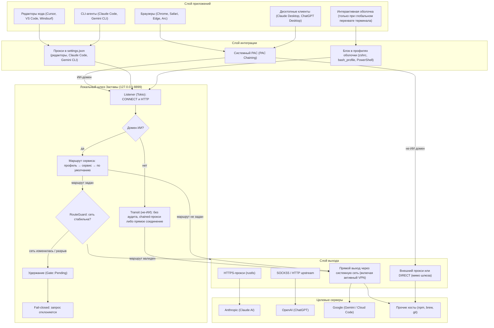

# Архитектура Застава v2.1.0

Документ описывает внутреннее устройство настольного приложения **Застава v2.1.0**: потоки данных, модульную структуру ядра на Rust и компонентную модель пользовательского интерфейса.

---

## 1. Общий стек и концепция

Застава построена на базе гибридного фреймворка **Tauri v2**:
* **Backend (Ядро)**: Rust (`src-tauri/`), асинхронный рантайм Tokio, TLS на базе `rustls` и `ring`. Выполняет функции локального шлюза, сторожа маршрутов, аудитора сети и менеджера системных настроек (прокси, PAC, файлы редакторов и CLI).
* **Frontend (Интерфейс)**: React 19, TypeScript, Vite, Tailwind CSS 4 (`src/`). Работает в WebView без прямого доступа к API операционной системы и обменивается с ядром типизированным IPC (`invoke` / `emit`).
* **Дизайн-система**: Zastava Design System (`src/ui/`, `src/styles/tokens.css`). Цвета задаются только CSS-переменными, сырых hex-значений в компонентах нет.

---

## 2. Схема движения трафика



---

## 3. Модули ядра Rust (`src-tauri/src/`)

```
src-tauri/src/
├── main.rs            # Точка входа; флаг --cleanup запускает возврат настроек без интерфейса
├── lib.rs             # Инициализация Tauri-плагинов, сборка стейта и регистрация IPC
├── app.rs             # Жизненный цикл приложения, фоновые задачи (проверка обновлений, шлюз)
├── proxy/             # Локальный шлюз, PAC, сторож маршрутов, радар покрытия
├── routing/           # Модель маршрутов v2, парсинг ключей, SSRF-валидация
├── auditor/           # 13 проверок сети, Claude Vault, правила (встроенные JSON)
├── sysproxy/          # Системные настройки, журнал владения, интеграция редакторов и CLI
├── commands/          # Тонкие IPC-хэндлеры Tauri, разбитые по доменам
├── state/             # Потокобезопасное состояние AppState и персистентность
├── tray/              # Системный трей / меню-бар; все операции с иконкой в главном потоке
├── updater/           # Проверка обновлений и установка только подписанного пакета
├── bin_checker/       # Проверка префикса платёжной карты: локальные правила и онлайн-справочник
└── sanctions.rs       # Проверка географических ограничений
```

### 3.1. `proxy/` — Шлюз, PAC и сторож маршрутов
* **`server.rs`**: асинхронный сервер на `127.0.0.1:8899` (при занятом порте — запасной). Принимает `HTTP CONNECT` и HTTP-запросы. Для доменов ИИ определяет маршрут и устанавливает туннель через `tokio::io::copy_bidirectional`. Для остальных доменов выполняет transit: без аудита и без гейта, через chained-прокси, а при его недоступности — напрямую (однократно). Цели проверяются политикой SSRF: порты `80`, `443`, `8443`; внутренние имена и приватные адреса отклоняются ответом `403`.
* **`http_forward.rs`**: разбор HTTP-запроса (абсолютная и относительная форма), очистка hop-by-hop заголовков, пересылка тела. Используется для plain HTTP в transit. Запросы к доменам ИИ по HTTP не пересылаются.
* **`transit.rs`**: исходящая сторона для transit: кэш DNS (положительные ответы 60 с, отрицательные 5 с, до 512 имён), проверка каждого ответа на приватные адреса, Happy Eyeballs (RFC 8305, шаг 250 мс).
* **`guard.rs` (`RouteGuard`)**: отслеживает отпечаток маршрутов ОС и внешний IP. При смене сети переводит шлюз в `Gate::Pending`: ИИ-запросы удерживаются до завершения проверки. Ручной «СТОП СЕТИ» останавливает весь проксируемый трафик, включая transit. Transit не зависит от гейта: перепроверка сети не обрывает уже идущие загрузки.
* **`hold_queue.rs` (`ConnectHoldQueue`)**: буфер новых соединений на время переключения маршрута.
* **`pac.rs`**: генератор `proxy.pac`. Первым правилом возвращает `DIRECT` для локальной сети (`*.local`, `10/8`, `172.16/12`, `192.168/16`, `169.254/16`, `127/8`). Затем домены ИИ уходят на шлюз, остальное — в `PROXY <chained>; DIRECT` либо в `DIRECT`.
* **`upstream.rs`**: клиенты внешних точек выхода: SOCKS5 / SOCKS5h, HTTP CONNECT, HTTPS-прокси на `tokio-rustls` (CONNECT внутри TLS до входной ноды).
* **`route_watch.rs` (`RouteWatch`)**: фоновый сторож активных upstream-маршрутов: статус и задержка, переключение на резервный узел.
* **`coverage.rs`**: радар «Покрытие приложений». Статус приложения — по факту: подтверждён трафиком через шлюз, настроен (по системной или файловой настройке), неизвестен или не настроен. Для обычного (transit) трафика `lsof` не вызывается; процесс по порту определяется кэшем с ограничением частоты.

### 3.2. `routing/` — Маршрутизация по сервисам и ключи v2
* **`mod.rs`**: структура `Route`, привязки сервисов (`provider_routes`), выбор маршрута (`Profile Route → Provider Route → Default Route`). Если маршрут не задан, выбирается `Direct`. Если маршрут задан, но недоступен, запрос отклоняется (fail-closed).
* **`key.rs`**: парсер ключей `zastava://` (версии 1 и 2) и прямых URL прокси. Поддерживает несколько входных узлов (`entry[]`), метки, `exit_ip`, срок действия. Пароли маскируются в `redacted_for_ui`.
* **`net.rs`**: проверка адресов входных узлов (SSRF-защита: loopback, приватные диапазоны, link-local, облачные метаданные `169.254.169.254`).

### 3.3. `auditor/` — 13 проверок сети и Claude Vault
* **`mod.rs`**: запуск 13 проверок, каждая в своей задаче с лимитом времени (`run_check`). Сбой или паника проверки даёт статус «Не удалось проверить», а не «Чисто». Итог: счётчики «пройдено / не удалось / требует внимания», флаг неполного отчёта.
* **`network.rs`**: сетевые метаданные по каскаду: `ipwho.is` → `ipinfo.io` → `freeipapi.com` → `1.1.1.1/cdn-cgi/trace`.
* **`probes/whoami.rs`**: проверка DNS-резолвера. Системный резолвер запрашивает `whoami.akamai.net` (A) и `o-o.myaddr.l.google.com` (TXT). Если оба источника не ответили, проверка получает статус «Не удалось проверить».
* **`probes/stun.rs`**: UDP/STUN-проба (`stun.cloudflare.com:3478`, `stun.l.google.com:19302`), сравнение адреса с адресом выхода.
* **`dnsbl.rs`**: параллельный опрос 5 зон (`zen.spamhaus.org`, `dnsbl.dronebl.org`, `b.barracudacentral.org`, `bl.spamcop.net`, `dnsbl-1.uceprotect.net`). Каждая зона проверяется контрольным адресом `127.0.0.2`. «Чисто» засчитывается при ответе минимум двух зон. Адреса вне `127.0.0.0/8` (например, fake-IP DNS) считаются непригодным ответом.
* **`geo_matrix.rs`**: матрица доступности сервисов по странам (правила в `rules/provider_matrix.json`).
* **`history.rs`**: история внешних IP, `IP Pinning` (в строгом режиме смена адреса даёт критичный статус) и `Impossible Travel`.
* **`os_env.rs` & `leaks.rs`**: часовой пояс (сравнение по смещению UTC, допуск 1 час), локаль и переменные `TZ`/`LANG`/`LC_TIME`, утечки IPv6, службы геолокации ОС.
* **`rules.rs`**: встроенные правила (`dangerous_asns.json`, `provider_matrix.json`), загружаются при сборке.
* **`cache_cleaner.rs`**: очистка кэша и сессионных меток Electron-клиентов с сохранением пользовательских конфигураций MCP-серверов.
* **`profile_switcher.rs`**: изолированные профили Claude Desktop: уникальные `device_id` в `ant-device-registry.json`, раздельное хранилище.
* **`claude_exporter.rs`**: экспорт контекста Claude Code (`~/.claude`): сессии, планы, `MEMORY.md`, сводная карта и `RESTORE_PROMPT.md`.

### 3.4. `sysproxy/` — Системные настройки и журнал владения
Застава восстанавливает только то, что изменила сама. Каждое изменение системной настройки или ключа в пользовательском файле проходит через журнал владения.

* **`journal.rs`**: журнал владения (`ownership/journal.json` в папке данных). Запоминает исходное значение и факт изменения; при возврате меняет значение, только если оно всё ещё принадлежит Заставе. Неизвестная версия схемы или испорченный файл — отказ (fail-closed). Файл не читается версиями до 2.1.0.
* **`fs.rs`**: файловый слой (через него проходят все записи и тесты).
* **`platform.rs`**: единственное место, которое вызывает `networksetup`, `launchctl`, `reg` и `scutil`. В тестах заменяется фейком; реальные вызовы ОС в тестах запрещены (проверяет CI).
* **`macos.rs`**: системный PAC macOS и его цепочка через `networksetup`, с сохранением исходного значения в журнале. **Пишет только в физические службы** (Wi-Fi, Ethernet, USB, Thunderbolt): служба типа `Physical` по `platform::classify_service`. VPN-служба (есть в `scutil --nc list` либо без `Device` в `networksetup -listnetworkserviceorder`) не читается для записи и не пишется ни PAC, ни цепочкой, ни списком исключений: запись в такую службу заставляет систему пересобрать её конфигурацию, и подключённый туннель может оборваться. Тип, который определить нельзя (список VPN недоступен), считается VPN. Если пропущена подключённая VPN-служба, в журнал и в «Покрытие» идёт одна строка «VPN-службы не изменялись: <имена>». Самолечение (`refresh_pac`, каждые ~5 с) читает перед записью и не пишет, если значение уже наше; если значение службы трижды за 120 с переписано не Заставой (VPN-клиент, другая утилита), эту службу оно больше не лечит до смены набора служб или повторного включения защиты (`HealGuard`).
* **Системный прокси поверх VPN.** Поле `system_proxy_effective` снимка покрытия читает `scutil --proxy` (только верхний словарь, без `__SCOPED__`) и сравнивает `ProxyAutoConfigEnable`/`ProxyAutoConfigURLString` с нашим PAC. Если PAC записан на физических службах, а глобально не действует (VPN перебивает), «Покрытие» говорит об этом прямо и ничего не пишет в VPN-службу сама.
* **`windows.rs`**: WinINet (`AutoConfigURL`, `ProxyEnable`) через реестр; вызовы без появления окна `cmd`.
* **`shell_rc.rs`**: помеченный блок в `~/.zshrc`, `~/.bash_profile` и профилях PowerShell. Используется только в режиме «Глобальный перехват терминала». `~/.zshenv` больше не пишется: старый блок удаляется по точным маркерам.
* **`ide.rs` & `jsonc.rs`**: точечное редактирование `settings.json` редакторов и CLI: ключи прокси и переменные `TZ`, `LANG`, `LC_TIME`. Комментарии JSONC сохраняются; остальной файл не переписывается.
* **`ai_cli.rs`**: `env` в `~/.claude/settings.json` и `~/.gemini/settings.json`. Прокси и часовой пояс записываются независимо друг от друга.
* **`cli_protection.rs`**: оркестрация включения и выключения. Режим `ai_only` (по умолчанию) пишет только настройки Claude Code, Gemini CLI и редакторов. Режим `global_terminal` дополнительно пишет блок в профили оболочки. Отдельный тумблер управляет подменой `TZ`/`LANG`/`LC_TIME`; `LC_ALL` не используется.
* **`cleanup.rs`**: сторож выхода (нормальный выход, сигналы SIGINT/SIGTERM, паника), команда `--cleanup`, однократная миграция наследия версий 1.3.x и 2.0.0 по признакам Заставы (подпись значения, маркеры блока, метка миграции `launchctl`). Остаток PAC версии 2.0.0 в VPN-службах (она писала во все включённые службы) снимается один раз (метка `legacy-2.0-vpn-services-pac-cleanup`) и только у службы в состоянии Disconnected, если значение равно нашему loopback-PAC; подключённая VPN-служба не трогается и не читается, остаток в ней безвреден (адрес не отвечает без Заставы, система идёт напрямую). Откат записей журнала по VPN-службам: подключённая пропускается (`Outcome::Skipped`, запись остаётся), отключённая восстанавливается. При запуске приложения остаток 2.0.0 на физической службе не снимается отдельно: включение защиты принимает его одной записью или ни одной (`Journal::apply`: PAC с нашим адресом без записи в журнале считается остатком, исходное состояние для отката — «выключен», запись пропускается, если значение уже наше).
* **`mod.rs`**: `os_effects_enabled()` — предохранитель: в тестах и при `ZASTAVA_OS_DRY_RUN` системные команды не запускаются.

### 3.5. `commands/` — Тонкие IPC-хэндлеры
Каждый файл группирует команды по функциональной области:
* `routes.rs` — добавление, удаление, привязка маршрутов и валидация ключей;
* `sysproxy.rs` — включение и выключение системного PAC, интеграция терминала и редакторов;
* `coverage.rs` — статусы покрытия приложений и повторная проверка;
* `audit.rs` — запуск 13 проверок сети;
* `claude.rs` — операции Claude Vault (переключение профилей, экспорт контекста);
* `crash_test.rs` — симуляция обрыва туннеля;
* `payment.rs` — проверка префикса карты (`bin_checker`);
* `upstream.rs` — управление legacy upstream-прокси;
* `domains.rs` — чтение и редактирование списка доменов ИИ;
* `updates.rs` — проверка обновлений и установка;
* `interception.rs` — параметры окна предупреждения;
* `deeplink.rs` — обработка ссылок `zastava://`.

### 3.6. `tray/` — Трей
Все обращения к `TrayIcon` и `MenuItem` (включая освобождение клонов) проходят через `tray::with_tray_on_main`, которая ставит работу в главный поток через `run_on_main_thread`. Стресс-тест трея (`tray/stress.rs`) работает только в отладочной сборке с feature `tray-stress` и переменной `ZASTAVA_TRAY_STRESS=1`.

---

## 4. Архитектура фронтенда (`src/`)

```
src/
├── main.tsx           # Точка входа React
├── App.tsx            # Корневой роутер экранов и глобальные провайдеры
├── ui/                # Атомарные компоненты дизайн-системы (без сырых hex)
├── features/          # Модульные экраны приложения
│   ├── overview/      # Экран «Обзор» (статус, быстрые действия, бейджи вкладок)
│   ├── connect/       # Экран «Подключение» (маршруты, ключи, ноды)
│   ├── checks/        # Экран «Проверки» (13 проверок, статусы и повтор)
│   ├── backup/        # Экран «Бэкап» (Claude Vault, экспорт памяти, кэш)
│   ├── guides/        # Экран «Гайды» (VPS, TZ, платёжная гигиена)
│   ├── onboarding/    # Мастер первого запуска
│   ├── alert/         # Окно предупреждения при смене сети (сразу, с догрузкой данных)
│   ├── crash-test/    # Модальное окно теста обрыва VPN
│   ├── subscription/  # Проверка BIN карт и таймер прогрева
│   └── settings/      # Окно настроек
├── shared/            # Общие хуки, утилиты форматирования, тексты
│   ├── copy/ru/       # Все пользовательские строки (статусы, проверки, покрытие)
│   ├── hooks/         # Хуки (useGatewayState, usePinning, useUpdater, ...)
│   ├── lib/           # Форматирование стран, дат, парсеры
│   └── version.ts     # Экспорт версии приложения
└── styles/            # Дизайн-токены, шрифты и стили
    ├── tokens.css     # Палитра, радиусы, тени, анимации
    ├── fonts.css      # Локальные шрифты (Golos Text + JetBrains Mono)
    └── zastava.css    # Глобальные базовые стили
```

### 4.1. Принципы изоляции дизайн-системы
1. **0 сырых hex-цветов**: во всех файлах `src/ui/` и `src/features/` запрещены шестнадцатеричные цвета (`#rrggbb`) и прямые `rgb()` / `rgba()`.
2. **Токенизация**: все цвета определены в `src/styles/tokens.css` и используются через семантические переменные (`var(--bg-canvas)`, `var(--text-primary)` и др.).
3. **Автоматический контроль**: `scripts/check-no-hex.mjs` (команда `pnpm lint:hex`) запускается в CI и блокирует нетокенизированные стили.

---

## 5. Модель потокобезопасности и персистентности

* Изменяемые глобальные данные ядра инкапсулированы в `AppState` (`src-tauri/src/state/mod.rs`) под защитой `tokio::sync::RwLock`.
* Состояние сохраняется в `state.json` в папке данных приложения (Tauri `app_data_dir`): macOS — `~/Library/Application Support/io.zastava.desktop/`, Windows — `%APPDATA%\io.zastava.desktop\`. Файл создаётся с правами `0600` на Unix.
* Журнал владения лежит в `ownership/journal.json` той же папки. Пока приложение работает, журнал удерживается блокировкой. При повреждённом или неизвестном журнале Застава не меняет системные настройки (fail-closed).
* При чтении `state.json` проверяется `schema_version`. Поддерживаются автоматические миграции конфигураций ранних версий (v1.x → v2.0) без потери настроек и списков профилей.
* Ключи маршрутов и пароли прокси хранятся в `state.json` в открытом виде; в интерфейсе и журналах событий они маскируются (`redacted_for_ui`).
