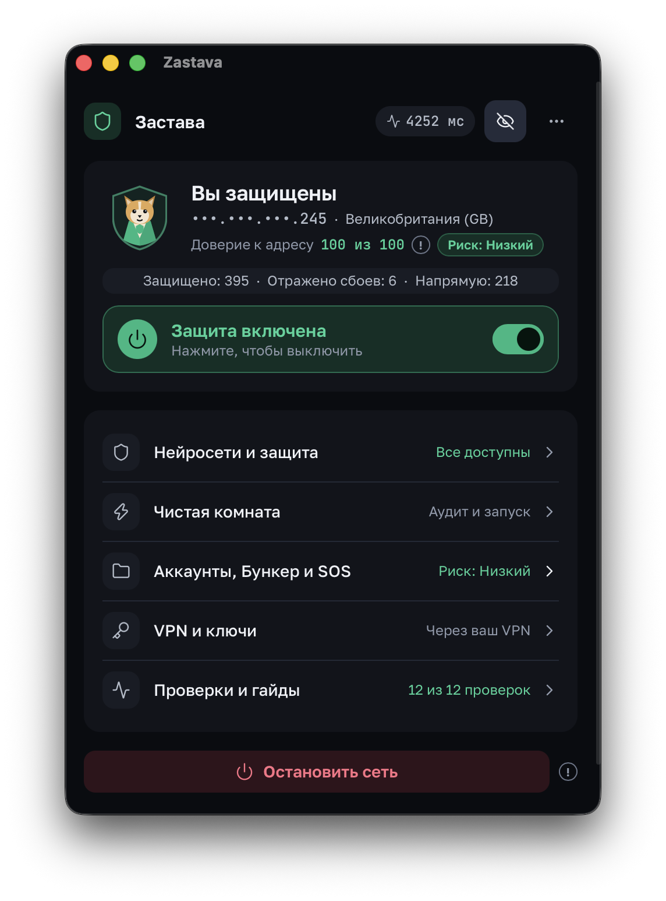
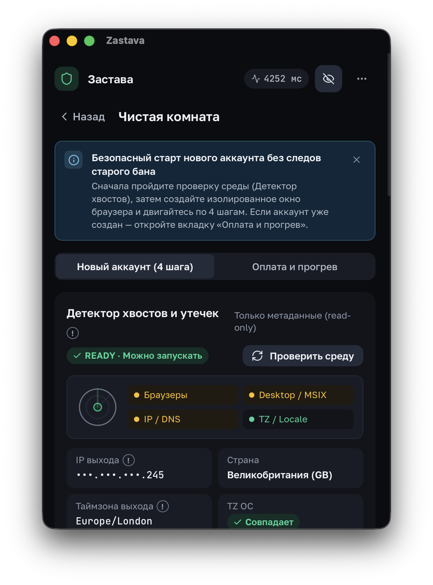
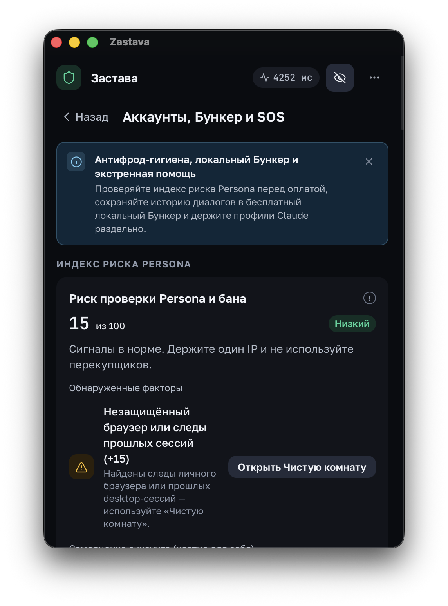
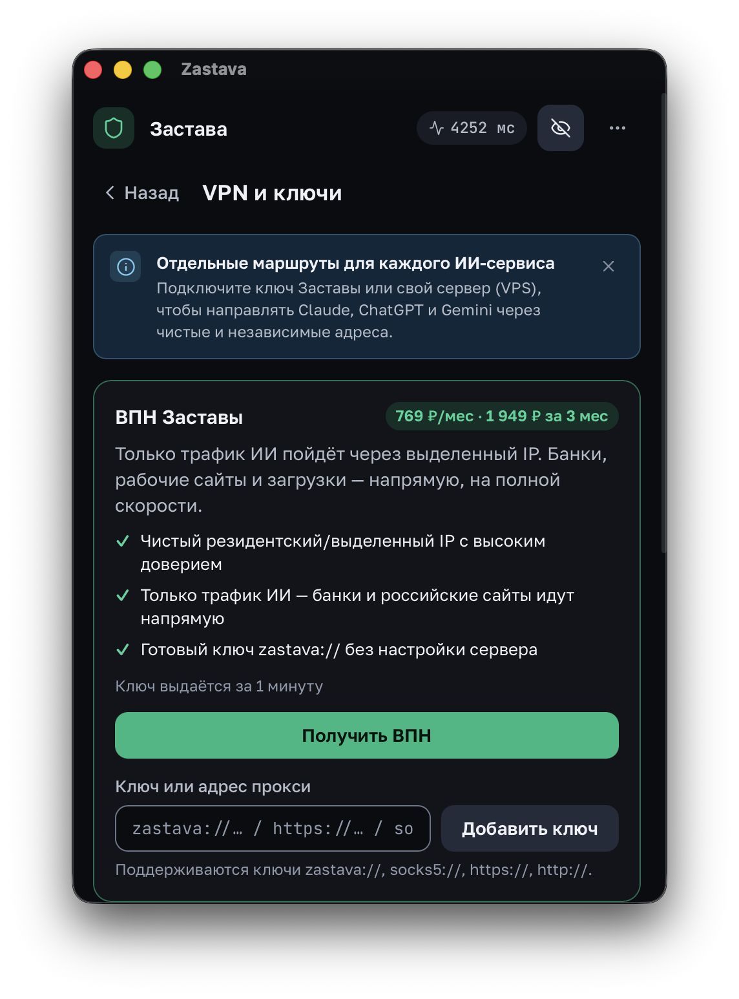
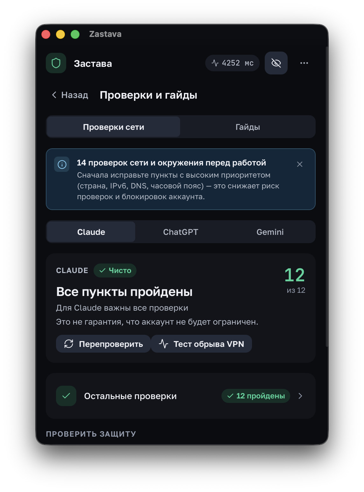
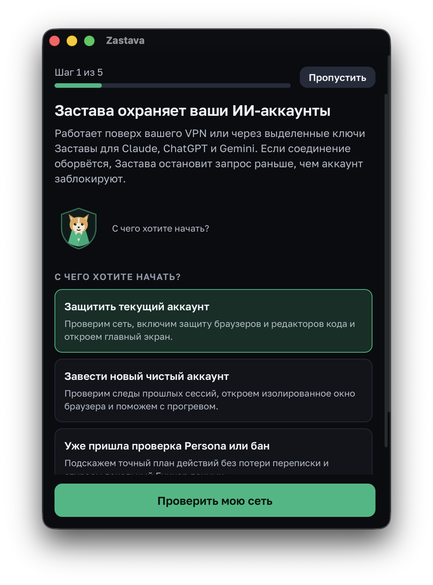

<div align="center">
  

  # Застава (`Zastava`) v3.1.0

  **Первый open-source рабочий кокпит для безопасной работы с Claude, ChatGPT, Cursor, Antigravity, Gemini и CLI-агентами.** Перехватывает обрыв VPN за `0.04 мс` до отправки запроса, изолирует браузерные сессии в **«Чистой комнате»** без split-IP утечек, автоматически спасает контекст в **локальном Бункере** и помогает безопасно оформить подписку, оценивая риск до оплаты и **SOS-верификации**.

  [](https://github.com/kingbest1195/ai-antiban/releases/latest)
  [%20%7C%20Windows%2010%2F11-18181b?style=for-the-badge)](#установка)
  [](#приватность-и-безопасность)
  [](LICENSE)

  <p align="center">
    <a href="https://github.com/kingbest1195/ai-antiban/releases/latest"><b>Скачать установщик (.dmg / .exe)</b></a> ·
    <a href="#застава-31-vs-обычный-vpn-vs-антидетект">Сравнение</a> ·
    <a href="#зачем-это-нужно">Возможности</a> ·
    <a href="#проверки-сети-14">14 проверок</a> ·
    <a href="#покрытие-приложений">Покрытие</a> ·
    <a href="#приватность-и-безопасность">Приватность</a> ·
    <a href="#сборка-из-исходников">Сборка</a>
  </p>
</div>

---

<p align="center">
  
  
  
</p>
<p align="center">
  
  
  
</p>

---

## Застава 3.1 vs обычный VPN vs антидетект

| Критерий | Обычный VPN | Антидетект-браузер | Застава v3.1.0 |
| :--- | :---: | :---: | :---: |
| **Остановка запроса при обрыве VPN (`0.04 мс` Kill-Switch)** | Нет (тихий слив домашнего IP) | Нет | **Да** |
| **Защита IDE и CLI (`Cursor`, `Claude Code`, `Antigravity`, `Gemini CLI`)** | Нет | Нет | **Да** |
| **Изолированная «Чистая комната» + Browser Sandbox (`127.0.1.x`)** | Нет | Частично | **Да (P0 без split-IP утечек)** |
| **Локальный Бункер (бэкап чатов/проектов + `RESTORE_PROMPT.md`)** | Нет | Нет | **Да (бесплатно)** |
| **Persona Risk Index + SOS-верификация** | Нет | Нет | **Да** |
| **14 проверок сети (DNSBL, PTR, Fake-IPv6, STUN, TZ, Exit IP)** | Нет | Нет | **Да** |
| **Прозрачность и приватность** | Закрытый / логи | Закрытый код, $30–100/мес | **Open Source (MIT), Zero-MITM, без телеметрии** |

---

## Зачем это нужно

Обычный VPN умеет тихо падать или переподключаться, пока вы пишете код в Cursor или общаетесь в Claude. Браузер и десктопные приложения этого не ждут — следующий запрос уходит с вашего настоящего IP. Сверху добавляются мелочи вроде московского часового пояса при лондонском IP, DNS домашнего провайдера или расхождения IP на **Stripe / Persona / Turnstile**.

Застава v3.1.0 решает это без второго VPN, без подписок на антидетект и без чтения вашей переписки:

* **Безопасная оплата подписок Claude.** Помогает выбрать подходящий способ оплаты («Через App Store — рекомендуем» или «Картой на сайте»), проверяет совместимость карты по первым 6–8 цифрам (полный номер, срок и CVV не запрашиваются и никуда не передаются), подсказывает адреса без налога со списком стран на русском языке (США — только для карт США или американского App Store), останавливает рискованную оплату при несовпадении страны карты, адреса и VPN, защищает маршрут на 3 дня после оплаты и включает пошаговый гайд для Т-Банк, СберБанк Онлайн, Kupikod, WantToPay и «Плати по миру».

* **Ловит обрыв за `0.04 мс` и скачок ASN до отправки запроса.** Локальный шлюз на `127.0.0.1:8899` держит запросы к ИИ, если VPN упал, сменился IP, страна или даже провайдер (`ASN`) внутри той же страны в пределах 4 часов (`TRAVEL_ASN_JUMP_SAME_COUNTRY`) — или активен 4-часовой таймер после безопасного выхода. Информативные жёлтые предупреждения без риска смены ASN трафик не блокируют, а при перехвате открывается окно «Было → Стало» с причиной (`gate_reason`), паузой «До следующей смены сети» или постоянным исключением `(Сервис + Exit IP)`.
* **«Чистая комната» и Browser Sandbox с пер-профильным loopback proxy alias (`127.0.1.x`).** Интерактивный мастер запуска нового или изолированного аккаунта («Новый аккаунт (4 шага)» и «Оплата и прогрев») с read-only детектором хвостов (процессы, браузеры, Desktop/MSIX, IP/DNS, `TZ/Locale`) и изолированными профилями браузера, где **весь** трафик (включая Stripe, Persona и Turnstile) строго заперт в своём маршруте без `transit_tunnel` fallback.
* **Бесплатный локальный Бункер, экспорт Cursor/веб-чатов и «SOS-верификация».** Единый локальный архив контекста (`Local Bunker`) с квотой диска (`500 МБ` по умолчанию, автоочистка старых снимков), автоматическим расписанием, санитизацией секретов (включая ручной ZIP-экспорт) и генерацией `RESTORE_PROMPT.md`, экспорт истории **Cursor**, **Claude Code**, **Claude Desktop** и веб-чатов (Claude / ChatGPT / Gemini), а также пошаговый экран **«SOS-верификация»** (SMS, KYC/Persona, оплата, разблокировка) и **Persona Risk Index** для оценки риска перед оплатой или проверкой.
* **Ключи Заставы (`zastava://`) и коммерческие прокси поверх любого VPN — стабильно на macOS и Windows.** Каждый ИИ-сервис может работать через свой ключ Заставы (`769 ₽/мес · 1 949 ₽ за 3 мес`, выдача за 1 минуту), собственный VPS или коммерческий прокси в формате `socks5://host:port:user:pass` / `host:port:user:pass` (Proxyma, Proxy6 и др.) поверх TUN/прокси VPN (`v2box`, `Happ`, `iNCY`, `Shadowrocket`, `Clash`, `Amnezia`) благодаря PAC-политикам браузеров, пер-сервисным тумблерам мониторинга (**Claude / ChatGPT / Gemini**), изолированной привязке IP/истории (`ip_history`, `PINNED_BY_ZASTAVA_KEY`), автоматическому fallback к публичным узлам входа через системный `chained_proxy` на Windows, Happy Eyeballs (без ложных блокировок на dual-stack IPv6), `SO_KEEPALIVE`, аварийному stale-кэшу DNS и диагностике фаз маршрута (`[proxy:route]`). На macOS `apply_pac` строго откатывает частичные правки при ошибке прав администратора, не оставляя ложно-зелёного статуса защиты.
* **Показывает 14 реальных проверок сети.** Не рисует зелёное там, где проверка не смогла достучаться до источника: при сбое честно показывает серый статус «Не удалось проверить», проверяет реальную Reverse DNS PTR-запись (`hickory-resolver`), честно помечает хостинги как `Datacenter / VPS IP (не резидентский)` и приоритизирует проверки по выбранному сервису (**Claude**, **ChatGPT**, **Gemini**). Под TUN/FakeDNS корректно распознаёт связку Fake-IP + публичный DNS и проверяет спам-базы через резервный DoH-канал.
* **Оболочка v3 `460×660`, маскот-сторож и 4-состоянный трей.** Главный экран перестроен в компактный zero-scroll хаб с быстрой кнопкой питания, списком защищённых контуров, экраном «Что нового» и анимированным маскотом-сторожем. Иконка в системном трее поддерживает 4 состояния (зелёный, жёлтый, красный и серый `tray-gray.png` при отключённой защите).
* **Автозапуск в трей и защита фоновых служб без ложных срабатываний.** Застава может запускаться свернутой в трей при входе в систему (`--minimized`). В v3.1.0 системный модуль для Windows полностью переписан на нативные механизмы ОС без скрытых фоновых скриптов и утилит, чтобы Windows Defender не реагировал ложными срабатываниями, а защита фоновой службы Claude (`CoworkVMService`) в 1 клик работает и на русской Windows.
* **Двухуровневый часовой пояс для ИИ и ОС.** Кнопка **«Синхронизировать для ИИ»** (*Рекомендуется*) мгновенно переводит проверку часового пояса в зелёный статус для приложений, CLI и IDE без смены системных часов ОС (подставляются только `TZ`, `LANG` и `LC_TIME` без `LC_ALL`). Кнопка синхронизации часового пояса системы доступна прямо в «Проверках» и на главном экране при расхождении, а новая настройка **«Сохранять часовой пояс ОС после выхода»** позволяет не запрашивать пароль администратора при каждом выходе и автообновлении.
* **Не мешает остальной жизни.** Принтеры по Wi-Fi, локальная сеть, `npm`, `brew`, `git` и обычные сайты идут мимо шлюза и ничего не теряют, а настройки VPN-клиентов (`utun*`, `scutil --nc` и временный DNS) Застава вообще не трогает.
* **Устойчивость под TUN Fake-IPv6, очистка кэша Windows MSIX и Build Provenance.** В проверках утечек добавлен анти-SSRF DNS fallback для TUN Fake-IPv6 (`leaks_dns.rs`), на Windows появилась безопасная очистка кэша MSIX-версии Claude (`cache_cleaner.rs`), а релизные сборки в GitHub Actions сопровождаются криптографическими аттестациями происхождения (`actions/attest-build-provenance`).
* **Чистый выход, нативный буфер обмена и безопасный апгрейд.** При выходе и установке обновления Застава показывает пошаговый прелоадер отката настроек и надёжно очищает системный прокси даже при работающем VPN (включая выход по сигналу ОС и спокойную подсказку, если открытые редакторы вроде Antigravity запомнили адрес подключения в памяти); перед миграцией `v2 → v3` однократно сохраняется `state.v2.bak.json`. Копирование промптов, CLI-команд, IP и логов работает через нативный буфер обмена (`pbcopy` / Win32 API), в шапке есть режим **«Скрыть IP»** для скриншотов, а для разбора проблем — экспорт очищенного диагностического отчёта (без ключей и IP).

---

## Установка

Установщики собираются в GitHub Actions из исходного кода этого репозитория и сопровождаются криптоподписью **minisign** и **GitHub Build Provenance (SLSA)**.

| Платформа | Установщик | Как поставить |
| :--- | :--- | :--- |
| **macOS** *(Apple Silicon и Intel)* | **[Скачать `Zastava_3.1.0_universal.dmg`](https://github.com/kingbest1195/ai-antiban/releases/latest)** | Откройте `.dmg` и перетащите **Zastava** в `Applications`. Приложение не подписано Apple Developer ID — если macOS предупреждает, выполните в Терминале:<br>`xattr -cr /Applications/Zastava.app` |
| **Windows 10 / 11** *(x64)* | **[Скачать `-setup.exe` или `.msi` (v3.1.0)](https://github.com/kingbest1195/ai-antiban/releases/latest)** | Запустите установщик. Приложение не подписано Microsoft Authenticode, SmartScreen может предупредить. |

> **Уже стоит 1.3.x, 2.x или 3.0.x?** Откройте меню `···` → **«Проверить обновления»**. Пакет обновления проверяется криптоподписью minisign до установки, а при переходе с `2.x` на `3.1.0` автоматически создаётся резервная копия `state.v2.bak.json`.

Все детали изменений — в [описании релиза](.github/release-notes.md) и [CHANGELOG.md](CHANGELOG.md).

---

## Как устроена защита

Застава работает в трёх контурах и показывает, где трафик реально идёт под защитой:

* **Браузеры и расширения** (`Chrome`, `Safari`, `Arc`, `Edge`, `Brave`, `Vivaldi`, `Yandex Browser`, `Firefox`, `Comet`, `Opera`, `Opera GX`, `Dia`, `OpenAI Atlas`, `Chrome/Brave Beta` и встроенные ИИ-расширения) — через системный PAC, управляемые политики браузеров и (на macOS) профильные `Preferences` Chromium: на шлюз уходят только домены ИИ (включая полный набор эндпоинтов Google/Gemini), остальной интернет идёт вашим обычным маршрутом (напрямую или через ваш VPN/прокси). При включённой защите Застава через журнал владения прописывает `ProxyMode = "pac_script"`, `ProxyPacUrl`, а также временно отключает QUIC/HTTP3 и встроенный DoH в браузерах на базе Chromium и Firefox (на Windows — только через политики `HKCU\Software\Policies` без чтения папок профилей); на macOS уже открытые браузеры можно перезапустить одной кнопкой **«Перезапустить браузеры»** (`--proxy-pac-url`), благодаря чему ключи Заставы работают поверх TUN VPN (V2Box Pro и др.), а при выключении возвращаются прежние значения. Службы самих VPN-клиентов на macOS Застава не изменяет.
* **Десктопные клиенты** (`Claude Desktop`, `ChatGPT Desktop`) — через системный прокси; если у вас несколько аккаунтов, в разделе «Бэкап» есть изолированные профили Claude Desktop с персональной привязкой маршрута (`zastava://`), архив контекста Claude Code (`~/.claude`) и кнопка **«Безопасный выход (смена IP / VPN)»**, которая мягко закрывает процессы Claude, очищает только cookies и хранилище сессий (**сохраняя `deviceId` и настройки MCP**) и запускает 4-часовой таймер смены сети на «Обзоре». В разделе «Гайды» доступны рекомендации по личным VPS (**HostVDS**, **Vultr**, **Timeweb Cloud**), проверка BIN карты, справочник платёжных адресов и предупреждение против покупки подписок через посредников (`Playerok`, `FunPay`, чужой Apple Pay).
* **IDE и CLI** (`Claude Code`, `Gemini CLI`, `Cursor`, `VS Code`, `Windsurf`, `Antigravity`) — через конфиги (`settings.json`) или запуск с адресом шлюза. Для **Antigravity 2.x** на macOS есть кнопка перезапуска с защитой прямо из Заставы. `JetBrains` пока в статусе «Неизвестно», пока формат настроек не подтверждён.

Локальный шлюз слушает `127.0.0.1:8899` (или запасной порт, если `8899` занят). В разделе «Подключение» каждому ИИ-сервису можно назначить свой маршрут (`zastava://`, внешний прокси или явный выбор `Напрямую`, даже если задан маршрут по умолчанию). Если маршрут не задан, трафик идёт через системную сеть (включая ваш VPN). Если заданный маршрут недоступен — Застава не пустит запрос в открытую сеть и остановит его.

---

## Проверки сети: 14

Запуск не тормозит окно и трей: пока идут первые пробы, интерфейс честно показывает «Проверяем». Каждая из 14 проверок выполняется отдельно со своим таймаутом. Если источник не ответил, статус становится серым — **«Не удалось проверить»** (а не «Чисто»). Итог выглядит как «Пройдено N из M», неполный отчёт помечается как «Проверено частично», при этом временное `Unknown` у проверок DNS-резолвера (кроме fake-IP) не окрашивает главный экран и сервисы в жёлтый цвет.

| № | Проверка | Что проверяется |
| :-: | :--- | :--- |
| **01** | **Страна выхода** | Поддерживается ли страна вашего выходного IP у Anthropic, OpenAI и Google. |
| **02** | **Провайдер адреса (`ASN`)** | Тип адреса выхода: `Datacenter / VPS IP (не резидентский)` (для личного VPS — без штрафа, с напоминанием избегать резких смен IP/ASN), жилой адрес, выход Tor или пул массового VPN. На IPv6-выходе список Tor помечается как «Не применимо». |
| **03** | **Спам-базы (`DNSBL`)** | Опрос 5 зон (`Spamhaus ZEN`, `DroneBL`, `Barracuda`, `SpamCop`, `UCEPROTECT` L1) с контрольным запросом к каждой. При блокировках системного резолвера или в режиме FakeDNS автоматически подключается резервный DoH-канал (`dns.google`). «Чисто» ставится, только если ответили минимум две зоны. |
| **04** | **Имя узла (`Reverse DNS PTR`)** | Реальный PTR-запрос через DNS (`hickory-resolver`, `rdns:ptr`) и проверка домена/провайдера на маркеры публичных анонимайзеров и прокси. |
| **05** | **Закреплённый IP (`IP Pinning`)** | Совпадает ли текущий выход с закреплённым адресом (хранится отдельно по маршрутам). Для сервисов на выделенном ключе Заставы привязка обеспечивается самим ключом (`PINNED_BY_ZASTAVA_KEY`) без конфликта с основным VPN. |
| **06** | **Скачки стран и ASN (`Impossible Travel`)** | Не сменилась ли страна за `< 4 ч`, а также не произошёл ли скачок между разными провайдерами/дата-центрами (`AS_A -> AS_B`) внутри одной страны за `< 4 ч` (`TRAVEL_ASN_JUMP_SAME_COUNTRY`) или во время активного 4-часового таймера после безопасного выхода (`ip_history` изолирован по маршрутам; смена IP внутри одного провайдера `AS_A -> AS_A` остаётся нормой). |
| **07** | **Утечка по `IPv6`** | Не уходит ли трафик мимо IPv4-туннеля через IPv6 (в режиме `split tunneling`, на TCP-ключе Заставы или при таймауте за VPN kill-switch проверка не выдаёт ложных тревог). |
| **08** | **DNS-резолвер** | Какой DNS-сервер реально видит запросы (некэшированный запрос `whoami.akamai.net` и `o-o.myaddr.l.google.com`). Распознаёт связку Fake-IP (`198.18.0.0/15`) + публичный DNS (Cloudflare, Google и др.) и чистый Fake-IP режим без резолверов РФ (`DNS_TUN_FAKE_IP_SAFE`). |
| **09** | **Страна `DNS`** | Совпадает ли страна резолвера со страной выхода в сеть (на ключе Заставы и в Fake-IP режиме ложные расхождения исключены). |
| **10** | **Службы геолокации ОС** | Не включены ли службы геолокации по Wi-Fi, которые могут выдать реальный город. |
| **11** | **Часовой пояс (`Timezone`)** | Двухуровневая проверка: кнопка **«Синхронизировать для ИИ»** сразу даёт зелёный статус (`TIMEZONE_SYNCED_AI`) для приложений, CLI и IDE без смены системных часов ОС; синхронизация часов ОС доступна как необязательная опция для веб-браузеров. |
| **12** | **Язык и окружение CLI/IDE** | Переменные `TZ`, `LANG`, `LC_TIME`, которые видят терминал и редакторы. |
| **13** | **UDP (`STUN`)** | Не идёт ли UDP мимо VPN-туннеля (STUN-проба через Cloudflare и Google). На выделенном TCP-ключе Заставы (при отключённом QUIC) зарубежный или заблокированный UDP не вызывает ложного предупреждения (`UDP_KEY_TCP_PROTECTED`). |
| **14** | **Выход до ИИ-сервисов** | Проверяет фактический выходной IP и страну через привязанный маршрут (или через нейтральный `1.1.1.1/cdn-cgi/trace`, если отдельный маршрут не привязан — без лишних прямых обращений к доменам ИИ с домашнего IP), выявляя расхождение при split tunneling или обходе прокси. |

Полный список внешних адресов, куда обращаются проверки, — в [PRIVACY.md](PRIVACY.md).

---

## Покрытие приложений

На вкладках «Обзор» и «Проверки» видно не просто «галочку в настройках», а факт работы:

* **Подтверждено трафиком** — Застава уже видела реальный запрос к ИИ от этого приложения;
* **Настроено — ждём первый запрос** — конфиг или системный прокси указывает на шлюз, ждём первый трафик;
* **Неизвестно** — нет надёжного способа проверить (например, JetBrains); вечную жёлтую точку на «Обзоре» этот статус не зажигает;
* **Не настроено** — защита для этого приложения выключена или не подхвачена.

Для каждого приложения есть короткая инструкция «Как настроить» с реальным адресом шлюза, автообновление статуса при возврате в окно и кнопка «Проверить снова». При активном TUN VPN в карточке сосуществования доступны быстрые действия: **«Перезапустить браузеры»** (в один клик для открытых браузеров без PAC), **«Привязать браузеры»** (или «Обновить привязку браузеров»), **«Перепроверить»** и **«Настройки сети ОС»**. Для **Antigravity 2.x** на macOS есть кнопка **«Перезапустить Antigravity с защитой»** — приложение мягко закрывается (без принудительного kill и потери несохранённых файлов) и открывается уже с прокси шлюза.

Настройки CLI и окружения разделены:

* **Режим «Только ИИ-клиенты и IDE»** *(по умолчанию)* — Claude Code, Gemini CLI и редакторы идут через Заставу, а обычный терминал (`npm`, `brew`, `git`, `cargo`) работает напрямую.
* **Режим «Глобальный перехват терминала»** — при необходимости добавляет помеченный блок прокси в интерактивные профили оболочки (`~/.zshrc`, `~/.bash_profile` или профиль PowerShell).
* **«Синхронизировать для ИИ» (*Рекомендуется*)** — меняет только `TZ`, `LANG` и `LC_TIME` для терминальных агентов и редакторов и мгновенно переводит проверку часового пояса в зелёный статус без изменения системных часов ОС. Переменная `LC_ALL` не используется.
* **Синхронизация системного времени ОС (*Опционально — только для браузера*)** — отдельная опция в настройках (через запрос прав администратора на macOS или UAC на Windows), если вам нужна подмена часового пояса именно внутри веб-браузеров, браузерных расширений или Claude Desktop (в «Покрытии» и окне часового пояса показывается ненавязчивое напоминание). Исходный часовой пояс и автоопределение сохраняются в `os_tz_baseline.json` и автоматически восстанавливаются при отключении, выходе или после сбоя.
* **Режим выборочной маршрутизации (split tunneling)** — переключатель в настройках для сценариев, когда VPN пропускает только отдельные домены или приложения: не блокирует работу из-за колебаний `1.1.1.1` и переводит IPv6-проверку в информационный режим.

---

## Безопасная очистка настроек

Перед каждой правкой Застава записывает исходное значение в журнал владения (`ownership/journal.json` в папке данных приложения). При выключении защиты, выходе, установке обновления, запуске `--cleanup` или удалении на Windows она восстанавливает **только** то, что меняла сама, и только пока значение всё ещё принадлежит ей. При выходе и перед перезапуском обновления отображается пошаговый экран прогресса (`ShutdownOverlay`), а до включения защиты доступен предпросмотр всех затрагиваемых системных настроек и файлов.

* Системный PAC на macOS и его цепочка (только физические сетевые службы), WinINet на Windows (через нативный Win32 API и корректную цепочку `REG_EXPAND_SZ`).
* Политики браузеров (`ProxyMode`, `ProxyPacUrl`, `QuicAllowed`, `DnsOverHttpsMode`, Firefox `DNSOverHTTPS`) — возвращаются к исходным значениям или удаляются при отключении защиты.
* Системный часовой пояс ОС (`os_tz_baseline.json`) — автоматически откатывается к исходному поясу и режиму автоопределения.
* `settings.json` редакторов и CLI-агентов правятся точечно, с сохранением JSONC-комментариев.
* Профили оболочки правятся только внутри маркеров с сохранением завершающего переноса строки; `~/.zshenv` и `launchctl` больше не загрязняются (а остатки от 2.0.0 аккуратно вычищаются).
* В `NO_PROXY` и первой строкой в PAC прописан прямой обход локальной сети (`localhost`, `*.local`, `10.0.0.0/8`, `172.16.0.0/12`, `192.168.0.0/16`, `169.254.0.0/16`), поэтому Wi-Fi-принтеры (AirPrint/IPP) и роутер работают напрямую.

---

## Тест обрыва VPN

Кнопка **«Тест обрыва VPN»** на главном экране имитирует обрыв на локальном шлюзе и по шагам показывает, как останавливается поток тестовых запросов (ваши реальные чаты и работа в этот момент не прерываются). Тест показывает реакцию шлюза наглядно, но не является гарантией от всех видов блокировок.

В реальной работе при обрыве VPN или смене IP сразу всплывает окно перехвата с причиной блокировки (`gate_reason`) — из него можно поставить защиту на паузу **«До следующей смены сети»**, разрешить принудительно (сохранив постоянное исключение `(Сервис + Exit IP)` с управлением в Настройках) или открыть памятку.

---

## Обновления

Встроенный апдейтер (`tauri-plugin-updater`) берёт обновления только с адреса, зашитого в `tauri.conf.json` (GitHub Releases, `latest.json`). Начиная с 2.1.0 пакет до установки проверяется криптоподписью minisign по публичному ключу в приложении — если подпись неверная, установка отменяется, а защита остаётся включённой. Автопроверку можно отключить в настройках. В разделе **«Настройки → Версия и откат»** также доступен подписанный откат на предыдущие релизы GitHub.

---

## Приватность и безопасность

* **Zero-MITM.** Застава не ставит корневые сертификаты и не расшифровывает HTTPS: для защищённых соединений шлюз видит только домен (`CONNECT`), содержимое идёт сквозным шифрованием. Обычный HTTP без шифрования пересылается прозрачно (для ИИ-доменов plain HTTP не допускается).
* **Никакой телеметрии и своих серверов.** Статистика и содержимое чатов никуда не отправляются. Внешние запросы идут только на проверки сети, фоновый контроль IP, проверку обновлений и (только по вашему нажатию) на проверку BIN карты — полный список в [PRIVACY.md](PRIVACY.md).
* **Только `127.0.0.1`.** Шлюз слушает только локальный интерфейс; туннели разрешены лишь на порты `80`, `443` и `8443`, а запросы во внутренние сети через шлюз отклоняются (`403 Forbidden`).
* **Режим «Скрыть IP» и безопасная диагностика.** Переключатель **«Скрыть IP»** в шапке маскирует IP-адреса и подсети во всём интерфейсе для безопасных скриншотов, а экспорт диагностического отчёта выгружает JSON без ключей `zastava://`, паролей и IP-адресов.
* **Локальное хранение.** Настройки (`state.json` с правами `0600` на macOS) и журнал владения хранятся локально: macOS — `~/Library/Application Support/io.zastava.desktop/`, Windows — `%APPDATA%\io.zastava.desktop\`.
* **Нашли уязвимость?** Пишите по инструкции в [SECURITY.md](SECURITY.md).

---

## Известные ограничения

* **Подпись ОС.** Приложение не подписано Apple Developer ID и Microsoft Authenticode: Gatekeeper, SmartScreen и антивирусы могут выдавать предупреждение.
* **Split tunneling (Throne, Amnezia и др.).** В настройках доступен переключатель **«Выборочная маршрутизация VPN (split tunneling)»**, а 14-я проверка «Выход до ИИ-сервисов» (`claude_exit`) проверяет реальный IP до ИИ-доменов. Чтобы общие сетевые пробы также шли через туннель, добавьте процесс `zastava` в правила вашего VPN.
* **Временные DNS VPN на macOS.** При выходе из Заставы под активным VPN с временными DNS откат PAC откладывается до следующего запуска.
* **Откат на 2.0.0.** Журнал владения 2.1.0+ не читается старыми версиями.
* **Аккаунты.** Даже все зелёные проверки — не абсолютная гарантия от ограничений аккаунта.

---

## Сборка из исходников

Требования: **Node.js 22+**, **pnpm 9+**, **Rust stable** (`cargo`).

```bash
git clone https://github.com/kingbest1195/ai-antiban.git
cd ai-antiban
pnpm install

# Тесты ядра Rust: эффекты ОС в тестах отключены по умолчанию
cargo test --manifest-path src-tauri/Cargo.toml

# Тесты фронтенда, проверка дизайн-системы (0 сырых hex-цветов) и архитектуры (CONSTITUTION.md)
pnpm test
pnpm lint:hex
node scripts/check-architecture.mjs --self-test

# Сборка фронтенда, запуск в режиме разработки и сборка установщика
pnpm build
pnpm tauri dev
pnpm tauri build
```

* **Документация:** [ARCHITECTURE.md](ARCHITECTURE.md) · [CONSTITUTION.md](CONSTITUTION.md) · [SECURITY.md](SECURITY.md) · [PRIVACY.md](PRIVACY.md) · [CONTRIBUTING.md](CONTRIBUTING.md) · [CHANGELOG.md](CHANGELOG.md)
* **Лицензия:** [MIT](LICENSE)
