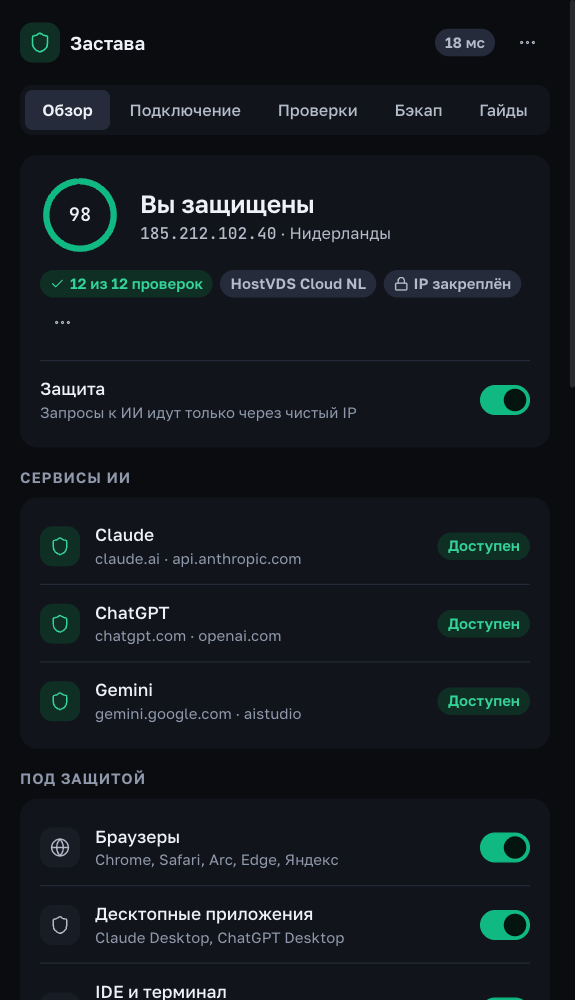
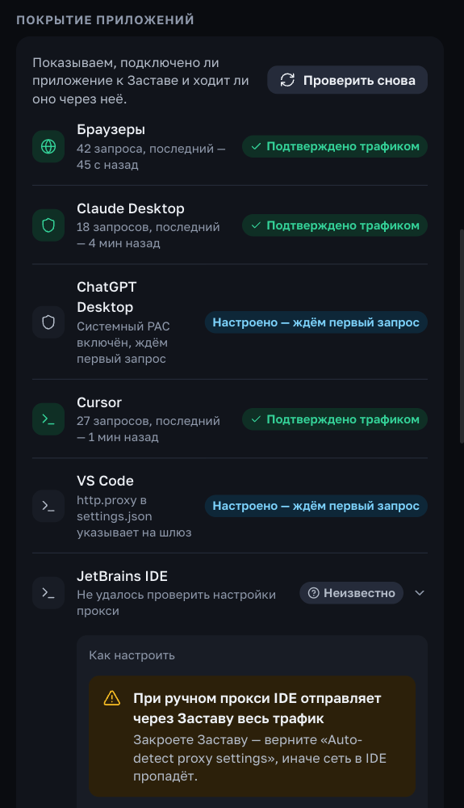
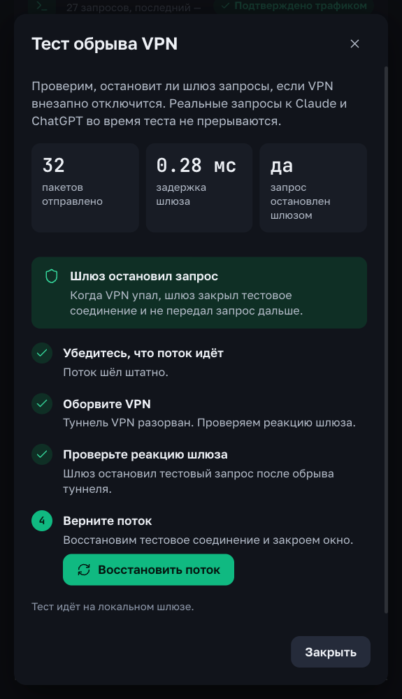

<div align="center">
  

  # Застава (`Zastava`) v2.1.2

  **Локальный сторож для работы с Claude, ChatGPT, Cursor, Antigravity, Gemini и CLI-агентами.** Проверяет сеть до отправки запроса и останавливает трафик к ИИ, если VPN отвалился, DNS ушёл к провайдеру или сменилась страна.

  [](https://github.com/kingbest1195/ai-antiban/releases/latest)
  [%20%7C%20Windows%2010%2F11-18181b?style=for-the-badge)](#установка)
  [](#приватность-и-безопасность)
  [](LICENSE)

  <p align="center">
    <a href="https://github.com/kingbest1195/ai-antiban/releases/latest"><b>Скачать установщик (.dmg / .exe)</b></a> ·
    <a href="#зачем-это-нужно">Зачем</a> ·
    <a href="#проверки-сети-14">14 проверок сети</a> ·
    <a href="#покрытие-приложений">Покрытие приложений</a> ·
    <a href="#приватность-и-безопасность">Приватность</a> ·
    <a href="#известные-ограничения">Ограничения</a> ·
    <a href="#сборка-из-исходников">Сборка</a>
  </p>
</div>

---

<p align="center">
  
  
  
</p>

---

## Зачем это нужно

Обычный VPN умеет тихо падать или переподключаться, пока вы пишете код в Cursor или общаетесь в Claude. Браузер и десктопные приложения этого не ждут — следующий запрос уходит с вашего настоящего IP. Сверху добавляются мелочи вроде московского часового пояса при голландском IP или DNS, который по-прежнему ходит к домашнему провайдеру.

Застава решает это без второго VPN и без чтения вашей переписки:

* **Ловит обрыв до отправки запроса.** Локальный шлюз на `127.0.0.1:8899` держит запросы к ИИ, если VPN упал, сменился IP или страна, и сразу открывает окно выбора «Было → Стало» в 2 кнопки: оставить паузу до смены сети или разрешить принудительно.
* **Показывает 14 реальных проверок сети.** Не рисует зелёное там, где проверка не смогла достучаться до источника: при сбое честно показывает серый статус «Не удалось проверить», а сами проверки приоритизируются по выбранному сервису (**Claude**, **ChatGPT**, **Gemini**). Временная недоступность DNS-резолвера (кроме fake-IP) не сбрасывает общий зелёный статус на главном экране.
* **Автозапуск в трей и защита фоновых служб.** Застава может запускаться свернутой в трей при входе в систему (`--minimized`) — на Windows 11 работа с реестром идёт напрямую через нативный Win32 API (`advapi32`), без запуска `reg.exe` — и предотвращает ранний фоновый запуск `CoworkVMService` до старта шлюза.
* **Выравнивает часовой пояс для ИИ-инструментов и ОС.** Для терминала и IDE подставляются только `TZ`, `LANG` и `LC_TIME` (без `LC_ALL`), а в настройках доступна кнопка синхронизации системного часового пояса ОС для браузеров и Claude Desktop с автоматическим откатом при выключении или выходе.
* **Не мешает остальной жизни.** Принтеры по Wi-Fi, локальная сеть, `npm`, `brew`, `git` и обычные сайты идут мимо шлюза и ничего не теряют, а настройки VPN-клиентов (`utun*`, `scutil --nc` и временный DNS) Застава вообще не трогает.
* **Аккуратно убирает за собой и помогает с диагностикой.** Перед любой правкой запоминает исходное состояние и при выключении возвращает только то, что меняла сама. Для macOS поддерживается повтор настройки через системный запрос прав администратора, а у ошибок есть кнопка **«Скопировать лог»** для быстрой отправки диагностики.

---

## Установка

Установщики собираются в GitHub Actions из исходного кода этого репозитория.

| Платформа | Установщик | Как поставить |
| :--- | :--- | :--- |
| **macOS** *(Apple Silicon и Intel)* | **[Скачать `.dmg` (v2.1.2)](https://github.com/kingbest1195/ai-antiban/releases/latest)** | Откройте `.dmg` и перетащите **Zastava** в `Applications`. Приложение не подписано Apple Developer ID — если macOS предупреждает, выполните в Терминале:<br>`xattr -cr /Applications/Zastava.app` |
| **Windows 10 / 11** *(x64)* | **[Скачать `-setup.exe` или `.msi` (v2.1.2)](https://github.com/kingbest1195/ai-antiban/releases/latest)** | Запустите установщик. Приложение не подписано Microsoft Authenticode, SmartScreen может предупредить. |

> **Уже стоит 1.3.x или 2.0.0?** Откройте меню `···` → **«Проверить обновления»**. Начиная с 2.1.0 пакет обновления проверяется криптоподписью minisign до установки.

Все детали изменений — в [описании релиза](.github/release-notes.md) и [CHANGELOG.md](CHANGELOG.md).

---

## Как устроена защита

Застава работает в трёх контурах и показывает, где трафик реально идёт под защитой:

* **Браузеры** (`Chrome`, `Safari`, `Arc`, `Edge`, `Brave`, `Firefox` и др.) — через системный PAC: на шлюз уходят только домены ИИ (включая полный набор из 34 доменов Google/Gemini и `clients6.google.com`, `accounts.google.com`, `ogs.google.com`), остальной интернет идёт вашим обычным маршрутом (напрямую или через ваш VPN/прокси). При включённой защите Застава через журнал владения временно отключает QUIC/HTTP3 и встроенный DoH в Chrome/Edge/Brave/Firefox, чтобы запросы не шли в обход локального PAC, и возвращает прежние значения при выключении. Службы самих VPN-клиентов на macOS Застава не изменяет.
* **Десктопные клиенты** (`Claude Desktop`, `ChatGPT Desktop`) — через системный прокси; если у вас несколько аккаунтов, в разделе «Бэкап» есть изолированные профили Claude Desktop с персональной привязкой маршрута (`zastava://`) и архив контекста Claude Code (`~/.claude`). В разделе «Гайды → Оплата» также доступны проверка BIN карты и справочник платёжных адресов.
* **IDE и CLI** (`Claude Code`, `Gemini CLI`, `Cursor`, `VS Code`, `Windsurf`, `Antigravity`) — через конфиги (`settings.json`) или запуск с адресом шлюза. Для **Antigravity 2.x** на macOS есть кнопка перезапуска с защитой прямо из Заставы. `JetBrains` пока в статусе «Неизвестно», пока формат настроек не подтверждён.

Локальный шлюз слушает `127.0.0.1:8899` (или запасной порт, если `8899` занят). В разделе «Подключение» каждому ИИ-сервису можно назначить свой маршрут (`zastava://`, внешний прокси или явный выбор `Напрямую`, даже если задан маршрут по умолчанию). Если маршрут не задан, трафик идёт через системную сеть (включая ваш VPN). Если заданный маршрут недоступен — Застава не пустит запрос в открытую сеть и остановит его.

---

## Проверки сети: 14

Запуск не тормозит окно и трей: пока идут первые пробы, интерфейс честно показывает «Проверяем». Каждая из 14 проверок выполняется отдельно со своим таймаутом. Если источник не ответил, статус становится серым — **«Не удалось проверить»** (а не «Чисто»). Итог выглядит как «Пройдено N из M», неполный отчёт помечается как «Проверено частично», при этом временное `Unknown` у проверок DNS-резолвера (кроме fake-IP) не окрашивает главный экран и сервисы в жёлтый цвет.

| № | Проверка | Что проверяется |
| :-: | :--- | :--- |
| **01** | **Страна выхода** | Поддерживается ли страна вашего выходного IP у Anthropic, OpenAI и Google. |
| **02** | **Провайдер адреса (`ASN`)** | Тип адреса выхода: хостинг (для личного VPS — норма без штрафа), жилой адрес, выход Tor или пул массового VPN. На IPv6-выходе список Tor помечается как «Не применимо». |
| **03** | **Спам-базы (`DNSBL`)** | Опрос 5 зон (`Spamhaus ZEN`, `DroneBL`, `Barracuda`, `SpamCop`, `UCEPROTECT` L1) с контрольным запросом к каждой. «Чисто» ставится, только если ответили минимум две зоны. |
| **04** | **Имя узла (`Reverse DNS PTR`)** | Обратная запись DNS: не светится ли адрес как типичный публичный прокси. |
| **05** | **Закреплённый IP (`IP Pinning`)** | Совпадает ли текущий выход с закреплённым адресом. В строгом режиме смена IP сразу даёт тревогу. |
| **06** | **Скачки стран (`Impossible Travel`)** | Не сменилась ли страна слишком быстро в рамках одной сессии. |
| **07** | **Утечка по `IPv6`** | Не уходит ли трафик мимо IPv4-туннеля через IPv6 (в режиме `split tunneling` носит информационный характер). |
| **08** | **DNS-резолвер** | Какой DNS-сервер реально видит запросы (некэшированный запрос `whoami.akamai.net` и `o-o.myaddr.l.google.com`). Разные адреса одного публичного оператора (Cloudflare, Google, Quad9, OpenDNS, AdGuard, NextDNS, Control D, Mullvad DNS) согласуются, при расхождении выводится пояснение. |
| **09** | **Страна `DNS`** | Совпадает ли страна резолвера со страной выхода в сеть. |
| **10** | **Службы геолокации ОС** | Не включены ли службы геолокации по Wi-Fi, которые могут выдать реальный город. |
| **11** | **Часовой пояс (`Timezone`)** | Совпадает ли системный часовой пояс ОС с поясом выходного IP (с допуском 1 час по UTC). Если подменён только CLI `TZ`, честно показывает предупреждение. |
| **12** | **Язык и окружение CLI/IDE** | Переменные `TZ`, `LANG`, `LC_TIME`, которые видят терминал и редакторы. |
| **13** | **UDP (`STUN`)** | Не идёт ли UDP мимо VPN-туннеля (STUN-проба через Cloudflare и Google). |
| **14** | **Выход до ИИ-сервисов** | Проверяет фактический выходной IP и страну напрямую до `claude.ai/cdn-cgi/trace`, `chatgpt.com/cdn-cgi/trace` и `ipinfo.io/json` через привязанный маршрут Gemini (`measured_via`), выявляя расхождение при split tunneling или обходе прокси. |

Полный список внешних адресов, куда обращаются проверки, — в [PRIVACY.md](PRIVACY.md).

---

## Покрытие приложений

На вкладках «Обзор» и «Проверки» видно не просто «галочку в настройках», а факт работы:

* **Подтверждено трафиком** — Застава уже видела реальный запрос к ИИ от этого приложения;
* **Настроено — ждём первый запрос** — конфиг или системный прокси указывает на шлюз, ждём первый трафик;
* **Неизвестно** — нет надёжного способа проверить (например, JetBrains); вечную жёлтую точку на «Обзоре» этот статус не зажигает;
* **Не настроено** — защита для этого приложения выключена или не подхвачена.

Для каждого приложения есть короткая инструкция «Как настроить» с реальным адресом шлюза, автообновление статуса при возврате в окно и кнопка «Проверить снова». Для **Antigravity 2.x** на macOS есть кнопка **«Перезапустить Antigravity с защитой»** — приложение мягко закрывается (без принудительного kill и потери несохранённых файлов) и открывается уже с прокси шлюза.

Настройки CLI и окружения разделены:

* **Режим «Только ИИ-клиенты и IDE»** *(по умолчанию)* — Claude Code, Gemini CLI и редакторы идут через Заставу, а обычный терминал (`npm`, `brew`, `git`, `cargo`) работает напрямую.
* **Режим «Глобальный перехват терминала»** — при необходимости добавляет помеченный блок прокси в интерактивные профили оболочки (`~/.zshrc`, `~/.bash_profile` или профиль PowerShell).
* **Независимый тумблер TZ и локали (CLI/IDE)** — меняет только `TZ`, `LANG` и `LC_TIME` для терминальных агентов и редакторов. Переменная `LC_ALL` больше не используется и не ломает консольные инструменты.
* **Синхронизация системного пояса ОС** — отдельная кнопка в настройках синхронизирует системный часовой пояс ОС (через запрос прав администратора на macOS или UAC на Windows), чтобы его видели **браузеры и Claude Desktop** (после переключения их нужно перезапустить). Исходный часовой пояс и автоопределение сохраняются в `os_tz_baseline.json` и автоматически восстанавливаются при отключении, выходе или после сбоя.
* **Режим выборочной маршрутизации (split tunneling)** — переключатель в настройках для сценариев, когда VPN пропускает только отдельные домены или приложения: не блокирует работу из-за колебаний `1.1.1.1` и переводит IPv6-проверку в информационный режим.

---

## Безопасная очистка настроек

Перед каждой правкой Застава записывает исходное значение в журнал владения (`ownership/journal.json` в папке данных приложения). При выключении защиты, выходе, запуске `--cleanup` или удалении на Windows она восстанавливает **только** то, что меняла сама, и только пока значение всё ещё принадлежит ей.

* Системный PAC на macOS и его цепочка (только физические сетевые службы), WinINet на Windows (через нативный Win32 API и корректную цепочку `REG_EXPAND_SZ`).
* Политики браузеров (`QuicAllowed` / `DnsOverHttpsMode` / Firefox `DNSOverHTTPS`) — возвращаются к исходным значениям или удаляются при отключении защиты.
* Системный часовой пояс ОС (`os_tz_baseline.json`) — автоматически откатывается к исходному поясу и режиму автоопределения.
* `settings.json` редакторов и CLI-агентов правятся точечно, с сохранением JSONC-комментариев.
* Профили оболочки правятся только внутри маркеров; `~/.zshenv` и `launchctl` больше не загрязняются (а остатки от 2.0.0 аккуратно вычищаются).
* В `NO_PROXY` и первой строкой в PAC прописан прямой обход локальной сети (`localhost`, `*.local`, `10.0.0.0/8`, `172.16.0.0/12`, `192.168.0.0/16`, `169.254.0.0/16`), поэтому Wi-Fi-принтеры (AirPrint/IPP) и роутер работают напрямую.

---

## Тест обрыва VPN

Кнопка **«Тест обрыва VPN»** на главном экране имитирует обрыв на локальном шлюзе и по шагам показывает, как останавливается поток тестовых запросов (ваши реальные чаты и работа в этот момент не прерываются). Тест показывает реакцию шлюза наглядно, но не является гарантией от всех видов блокировок.

В реальной работе при обрыве VPN или смене IP сразу всплывает окно перехвата — из него можно заблокировать запрос, разрешить его на текущую сессию или открыть памятку.

---

## Обновления

Встроенный апдейтер (`tauri-plugin-updater`) берёт обновления только с адреса, зашитого в `tauri.conf.json` (GitHub Releases, `latest.json`). Начиная с 2.1.0 пакет до установки проверяется криптоподписью minisign по публичному ключу в приложении — если подпись неверная, установка отменяется, а защита остаётся включённой. Автопроверку можно отключить в настройках.

---

## Приватность и безопасность

* **Zero-MITM.** Застава не ставит корневые сертификаты и не расшифровывает HTTPS: для защищённых соединений шлюз видит только домен (`CONNECT`), содержимое идёт сквозным шифрованием. Обычный HTTP без шифрования пересылается прозрачно (для ИИ-доменов plain HTTP не допускается).
* **Никакой телеметрии и своих серверов.** Статистика и содержимое чатов никуда не отправляются. Внешние запросы идут только на проверки сети, фоновый контроль IP, проверку обновлений и (только по вашему нажатию) на проверку BIN карты — полный список в [PRIVACY.md](PRIVACY.md).
* **Только `127.0.0.1`.** Шлюз слушает только локальный интерфейс; туннели разрешены лишь на порты `80`, `443` и `8443`, а запросы во внутренние сети через шлюз отклоняются (`403 Forbidden`).
* **Локальное хранение.** Настройки (`state.json` с правами `0600` на macOS) и журнал владения хранятся локально: macOS — `~/Library/Application Support/io.zastava.desktop/`, Windows — `%APPDATA%\io.zastava.desktop\`.
* **Нашли уязвимость?** Пишите по инструкции в [SECURITY.md](SECURITY.md).

---

## Известные ограничения

* **Подпись ОС.** Приложение не подписано Apple Developer ID и Microsoft Authenticode: Gatekeeper, SmartScreen и антивирусы могут выдавать предупреждение.
* **Split tunneling (Throne, Amnezia и др.).** В настройках доступен переключатель **«Выборочная маршрутизация VPN (split tunneling)»**, а 14-я проверка «Выход до ИИ-сервисов» (`claude_exit`) проверяет реальный IP до ИИ-доменов. Чтобы общие сетевые пробы также шли через туннель, добавьте процесс `zastava` в правила вашего VPN.
* **Fake-IP DNS (TUN-режим).** При fake-IP DNS проверка DNSBL честно показывает «Не удалось проверить».
* **Временные DNS VPN на macOS.** При выходе из Заставы под активным VPN с временными DNS откат PAC откладывается до следующего запуска.
* **Восстановление файлов.** При откате пользовательских файлов в редких случаях может теряться финальный перенос строки, а пустой `settings.json` возвращается как `{}`.
* **Откат на 2.0.0.** Журнал владения 2.1.0 не читается старыми версиями.
* **Аккаунты.** Даже все зелёные проверки — не абсолютная гарантия от ограничений аккаунта.

---

## Сборка из исходников

Требования: **Node.js 22+**, **pnpm 9+**, **Rust stable** (`cargo`).

```bash
git clone https://github.com/kingbest1195/ai-antiban.git
cd ai-antiban
pnpm install

# Тесты ядра Rust: эффекты ОС в тестах отключены по умолчанию
cargo test --manifest-path src-tauri/Cargo.toml

# Тесты фронтенда и проверка дизайн-системы (0 сырых hex-цветов)
pnpm test
pnpm lint:hex

# Сборка фронтенда, запуск в режиме разработки и сборка установщика
pnpm build
pnpm tauri dev
pnpm tauri build
```

* **Документация:** [ARCHITECTURE.md](ARCHITECTURE.md) · [SECURITY.md](SECURITY.md) · [PRIVACY.md](PRIVACY.md) · [CONTRIBUTING.md](CONTRIBUTING.md) · [CHANGELOG.md](CHANGELOG.md)
* **Лицензия:** [MIT](LICENSE)
